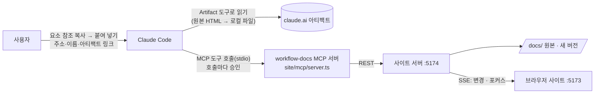

# 3.0 요구사항(리서치): Claude Code가 사이트 문서를 직접 다루기

지금은 Claude Code에서 파일을 만든 뒤 사이트의 업로드 버튼으로 등록하고, 화면에서 손으로 고친다. 3.0에서는 **Claude Code가 사이트 문서를 직접 찾고, 고치고, 등록**하게 한다.

> 상태: **v0.5** (2026-10-08). D-23~D-29 결정, 3.1~3.4 완료(계획과 결과는 7절). 테스트: `cd site && npm test`(케이스는 `TESTING.md`).

---

## 1. 하고 싶은 일

| # | 시나리오 | 예 |
|---|---|---|
| 1 | 문서를 주소·이름으로 지정 | "http://localhost:5173/sdlc/code-review-automation/review-modes 문서 열어 줘", "SDLC > 코드 리뷰 자동화 > 리뷰 방식 비교" |
| 2 | 문서 안 요소를 지정해 고치기 | 화면에서 고를 문단을 찍어 "이 문장을 이렇게 바꿔 줘" |
| 3 | 새 문서·새 버전 등록 | Claude Code가 만든 HTML·Markdown·DOCX를 바로 메뉴에 등록 |
| 4 | 다른 아티팩트 가져오기 | `https://claude.ai/artifact/…` 내용을 사이트 문서로 등록 |
| 5 | 그 밖의 관리 | 메뉴 만들기, 상태 확정(v1.0), 검색 |

## 2. 지금 막혀 있는 곳

| 막힘 | 이유 |
|---|---|
| Claude Code가 사이트 기능을 쓸 통로가 없다 | 사이트 API(REST)는 있지만 Claude Code에 도구로 연결돼 있지 않다. 매번 curl 명령을 짜야 한다 |
| react-grab으로 문서 안 요소를 못 고른다 | react-grab은 **사이트(바깥) 문서의 React 컴포넌트**만 본다. 문서는 iframe 안의 별도 문서이고, 보기 모드에서는 보안상 사이트가 iframe 안에 접근할 수 없다(sandbox, 다른 출처) |
| 아티팩트를 사이트 서버가 직접 받을 수 없다 | claude.ai 아티팩트는 Claude 계정으로만 읽힌다. 사이트 서버에는 그 권한이 없고, **Claude Code의 Artifact 도구**만 읽을 수 있다 |

## 3. 방식 비교

| 방식 | 내용 | 장점 | 단점 | 판단 |
|---|---|---|---|---|
| **A. 프로젝트 MCP 서버** | 사이트 API를 감싼 MCP 서버(`workflow-docs`)를 리포에 두고 `.mcp.json`으로 Claude Code에 등록 | 도구 이름·인자가 정해져 있어 Claude가 정확히 호출. 주소·참조 해석, 로컬 파일 업로드, 충돌 검사를 서버가 맡음. 호출마다 사용자 승인 | 개발 필요(서버 1개, 도구 10여 개) | **제안** |
| B. curl + 스킬 문서 | 스킬 문서에 API 사용법만 적어 두고 Claude가 curl로 호출 | 개발이 거의 없음, 바로 가능 | 조각 해시·multipart 업로드를 매번 직접 조립. 실수가 잦고 승인 요청이 많음 | 보조(서버가 꺼졌을 때 대안 안내 정도) |
| C. 파일 직접 수정 | Claude가 `docs/`의 파일과 meta.yaml을 직접 고치면 감시가 반영 | 추가 개발 없음 | 버전 규칙(새 버전, 기존 폴더 불변), 해시 충돌 검사, 조각 단위 교체를 우회해 문서가 깨지기 쉬움 | 쓰지 않음 |
| D. 브라우저 자동화 | Claude in Chrome 등으로 사이트 화면을 대신 조작 | 화면 그대로 | 느리고 깨지기 쉬움. 화면이 바뀌면 동작 불가 | 쓰지 않음 |

### 요소 지정 방식 비교

| 방식 | 판단 |
|---|---|
| react-grab을 iframe 안에도 띄우기 | 문서 HTML에 스크립트를 넣어야 해서 원본이 바뀐다. 보기 모드 보안 설정과도 맞지 않는다 → **쓰지 않음** |
| **사이트에 "요소 참조 복사" 모드 추가** | 2.0 편집 모드와 같은 방식(같은 출처·스크립트 없음)으로 iframe을 열고, 누른 글자의 **조각 참조**를 클립보드에 복사한다. Claude Code에 붙여 넣으면 MCP가 해석한다 → **제안** |
| CSS 선택자·글자 검색으로 지정 | 참조 없이도 "‘D7 첫 리뷰’라는 문장"처럼 말하면 MCP 검색 도구로 찾는다 → **보조로 함께 제공** |

## 4. 제안 구조



- MCP 서버는 사이트 서버(`npm run dev`)의 REST API를 부른다. 저장 규칙·충돌 검사·실시간 반영이 화면 편집과 **같은 코드**를 거친다.
- 서버가 꺼져 있으면 도구가 "사이트 서버가 꺼져 있습니다. `cd site && npm run dev`" 안내를 돌려준다.

### 4.1 문서 참조 형식

하나의 형식으로 사람이 붙여 넣고, 브라우저로 열고, MCP가 해석한다.

```
http://localhost:5173/sdlc/code-review-automation/review-modes?v=v1.0&seg=123
                     └ 대분류/메뉴/문서 ┘                       └ 버전 ┘└ 조각 ┘
```

- `seg` 없이 주소만 주면 문서 전체, `v` 없으면 최신 버전이다.
- `seg=120-135`처럼 범위로 블록(섹션 등) 하나를 가리킬 수 있다.
- 주소 대신 "SDLC > 코드 리뷰 자동화 > 리뷰 방식 비교"처럼 이름으로 말해도 MCP가 검색으로 찾는다.
- 브라우저에서 이 주소를 열면 해당 조각으로 스크롤하고 강조한다.

### 4.2 MCP 도구(안)

| 도구 | 하는 일 | 쓰는 API |
|---|---|---|
| `list_documents` | 대분류 → 메뉴 → 문서 트리 | `GET /api/tree` |
| `find_documents` | 이름·본문 검색 | `GET /api/search` |
| `get_document` | 주소·이름으로 문서 정보·버전 목록 | `GET /api/docs/:menu/:doc` |
| `get_text` | 텍스트 조각 목록(참조 범위·검색어로 좁히기, 앞뒤 문맥 포함) | `GET .../segments` |
| `edit_text` | 조각 id 또는 "찾을 글자 → 바꿀 글자"로 고쳐 새 버전 저장 | `POST .../text-edit` |
| `save_markdown` | Markdown 문서 내용 저장(새 버전) | `POST .../edit` |
| `upload_document` | 로컬 파일(들)로 새 문서 등록. 아티팩트에서 저장한 HTML도 이 도구로 | `POST /api/upload` |
| `upload_version` | 기존 문서에 새 버전 파일 올리기 | `POST /api/upload` |
| `create_menu` | 메뉴 만들기 | `POST /api/menus` |
| `release_document` | 정식 버전(v1.0)으로 확정 | `POST .../release` |
| `focus_in_site` | 열려 있는 사이트 화면을 그 문서·조각으로 이동시키고 강조 | SSE 이벤트(신규) |

- **휴지통·영구 삭제·메뉴 삭제는 MCP에 넣지 않는다**(제안, D-24). 되돌리기 어려운 작업은 사이트 화면의 확인 창에서만 한다.
- Claude Code가 도구를 부를 때마다 승인을 묻는 것이 사이트의 "확인 창" 역할을 한다.

### 4.3 아티팩트 등록 흐름

```
사용자: "https://claude.ai/artifact/9w3z… 를 SDLC > 온보딩에 등록해"
  1. Claude Code: Artifact 도구 read → 원본 HTML을 로컬 파일로 저장 (여러 파일이면 files 목록을 모두 받음)
  2. Claude Code: upload_document(menu="onboarding", title="플랫폼팀 개발 환경", files=[저장 경로], origin="https://claude.ai/artifact/9w3z…")
  3. 사이트: 새 문서 draft(v0.0) 생성, 목록·화면에 바로 표시, meta.yaml에 출처(origin_url) 기록
```

- 확인 결과 예시 아티팩트(`9w3zrAXkgcpU26gTufpiGw`)는 **외부 리소스 없는 단일 HTML**(제목 "플랫폼팀 개발 환경")이라 그대로 올릴 수 있다.
- 다만 **조직 밖 작성자의 공개 아티팩트**로 표시된다. 신뢰할 수 없는 HTML이므로 보기 정책을 정해야 한다(D-25).

### 4.4 사이트 쪽 추가

| 기능 | 내용 |
|---|---|
| **요소 참조 복사** | 문서 상단 "참조 복사" 버튼 → 편집 모드처럼 iframe을 열고 글자에 마우스를 올리면 강조, 누르면 4.1 형식 주소가 클립보드로. Alt+클릭은 감싸는 블록 전체(조각 범위). DOCX·PPTX·XLSX는 목록 줄마다 복사 버튼 |
| `?seg=` 강조 | 주소에 조각이 있으면 그 위치로 스크롤하고 잠깐 강조 |
| Claude 작업 표시 | MCP로 만든 버전은 변경 메모 앞에 "Claude Code:"를 붙인다(D-26). 화면에 "Claude Code가 v0.3을 저장함" 알림 |
| 출처 표시 | 아티팩트 등 외부에서 가져온 문서는 상단에 출처 링크 |

## 5. 단계 계획

| 단계 | 내용 | 완료 기준 |
|---|---|---|
| 3.1 MCP 기본 ✅ | `site/mcp/server.ts`(MCP SDK, stdio), 조회·검색·텍스트 조회/편집·Markdown 저장·업로드·메뉴·확정 도구, 주소·이름 해석, `.mcp.json` 등록, 사용 스킬 문서 | Claude Code에서 "리뷰 방식 비교 문서의 ‘…’를 ‘…’로 바꿔 줘" → 새 버전이 사이트에 바로 보임. 로컬 HTML을 새 문서로 등록 |
| 3.2 요소 참조 ✅ (계획 7.2) | 사이트 "참조 복사" 모드, `?seg=` 강조, MCP의 참조 해석(범위·문맥) | 화면에서 문단을 찍어 복사 → Claude Code에 붙여 넣고 수정 지시 → 그 문단만 바뀜 |
| 3.3 아티팩트 가져오기 ✅ (계획 7.1) | 출처 기록·표시, 여러 파일 아티팩트, 외부 HTML 보기 정책 | 예시 아티팩트를 한 문장 지시로 등록 |
| 3.4 실시간 표시 ✅ (계획 7.3) | `focus_in_site`, Claude 저장 알림 | Claude가 고치면 열린 화면이 그 문서로 이동해 바뀐 곳을 강조 |

## 6. 결정 사항

| ID | 질문 | 결정 (2026-10-08) |
|---|---|---|
| D-23 | 연결 방식 | **프로젝트 MCP 서버**(A). curl 스킬(B)은 쓰지 않는다 |
| D-24 | MCP에 넣을 쓰기 범위 | 텍스트 편집·Markdown 저장·업로드·새 버전·메뉴 만들기·정식 확정까지. **휴지통·영구 삭제·메뉴 삭제는 제외**(화면에서만) |
| D-25 | 외부에서 가져온 HTML 보기 | 출처 표시 + **처음에는 스크립트를 끈 채로 보여 주고**, "스크립트 켜기"를 눌러야 실행 |
| D-26 | Claude가 만든 버전 표시 | **변경 메모 앞에 "Claude Code:"**. `source`(upload·edit·text-edit)는 그대로 둔다 |
| D-27 | 외부 문서 "스크립트 켜기"를 기억할까 | **그 브라우저에서 문서·버전별로 기억**(localStorage). 새 버전이 생기면 다시 꺼진다. 배너에서 언제든 다시 끈다 |
| D-28 | `?seg=` 강조 화면 | **스크립트 없는 참조 보기**: 텍스트 편집과 같은 사본(조각 표시, 스크립트 없음)을 읽기 전용으로 열어 강조. 상단 막대에서 원래 보기로 돌아간다 |
| D-29 | Claude 저장을 열린 화면에 보여 주는 방식 | **알림 + "열기"**. 같은 문서를 보고 있으면 바뀐 조각을 강조하고, 다른 문서를 보고 있으면 이동하지 않는다. `focus_in_site`를 부르면 그때 이동한다 |

## 7. 3.2~3.4 개발 계획 (2026-10-08)

진행 순서는 **3.3 → 3.2 → 3.4**다. 외부 아티팩트 문서(`onboarding/platform-env`)가 이미 등록되어 있고 지금은 스크립트가 그대로 실행되므로, 보기 정책(3.3)을 먼저 한다. 3.4의 "바뀐 곳 강조"는 3.2의 참조 보기를 쓰므로 3.2 뒤에 한다.

### 7.1 3.3 외부 문서 보기 정책

| 영역 | 작업 |
|---|---|
| 화면 | 문서 정보에 `originUrl`을 받는다. 출처가 있으면 상단에 **출처 막대**: "외부 문서 · 출처 링크 · 스크립트 꺼짐 [스크립트 켜기]". 켜면 "스크립트 켜짐 [끄기]" |
| HTML 보기 | `HtmlViewer`에 `scripts` 옵션. 외부 문서는 기본으로 sandbox에서 `allow-scripts`를 뺀다. 프레젠테이션 모드도 같은 설정을 따른다 |
| 기억 | localStorage `workflow:scripts:<메뉴>/<문서>@<버전>`(D-27). 다른 버전은 꺼진 상태로 시작 |
| 출처 관리 | 문서 관리 대화상자에서 출처 주소를 보고 고친다(`PATCH /api/docs/:menu/:doc`에 `origin`, 빈 값이면 삭제, http(s)만) |
| 여러 파일 아티팩트 | 스킬 문서에 절차 추가: Artifact `list scope=files` → 파일을 한 폴더에 저장 → `upload_document`(폴더, `entry`, `origin`) |
| 테스트 | API: 출처 수정·검증. 화면: 외부 문서는 `allow-scripts` 없음, 켜기·기억·새 버전에서 다시 꺼짐, 출처 없는 문서는 막대 없음 |

### 7.2 3.2 요소 참조

| 영역 | 작업 |
|---|---|
| 참조 보기(HTML) | `viewers/HtmlRefView.tsx`: 편집 사본(`edit-view`)을 스크립트 없이 같은 출처로 열고 읽기 전용으로 쓴다. 두 가지 쓰임 |
| ① `?seg=` 강조 | 주소에 `seg`가 있으면 일반 보기 대신 참조 보기를 열고, 그 조각(범위·목록)으로 스크롤해 강조한다. 상단 막대 "참조 위치 [12–15] 표시 중 · 원래 보기로"(D-28) |
| ② 참조 복사 | 문서 상단 "참조 복사" 버튼 → 글자에 마우스를 올리면 테두리, 누르면 그 조각 주소(`…?v=<버전>&seg=<id>`)를 클립보드로. **Alt+클릭**은 감싸는 블록(문단·목록 항목·제목·표 칸·pre) 전체를 `seg=<처음>-<끝>`으로. 복사하면 "복사함: [12] ‘글자…’" 안내 |
| DOCX·PPTX·XLSX | `viewers/SegmentRefList.tsx`: 편집기와 같은 문단 묶음의 읽기 전용 목록. 줄마다 복사 버튼, 문단 제목에 문단 전체(범위) 복사. `?seg=`면 그 줄로 스크롤·강조 |
| 버전 | 이전 버전에서도 참조를 복사할 수 있다(주소에 `v`가 들어간다). MCP는 이전 버전 참조로는 고치지 않고 최신 버전 확인을 안내한다(기존 동작) |
| `seg` 형식 | `12`, `12-15`에 더해 목록 `3,10-12`도 받는다(3.4에서 바뀐 조각 여러 곳 강조). 화면·MCP 공통 해석 함수 |
| 테스트 | 화면: 참조 복사(조각·Alt 블록) 클립보드 내용, `?seg=` 스크롤·강조·원래 보기로. MCP: 목록 형식 seg 해석 |

### 7.3 3.4 실시간 표시

| 영역 | 작업 |
|---|---|
| Claude 저장 표시 | MCP가 쓰기 요청에 `X-Workflow-Agent: claude-code` 헤더를 붙인다. 서버는 변경 알림(SSE)에 `by`, 문서(대분류·메뉴·문서·제목), 새 버전, 바뀐 조각 id를 담는다 |
| 화면 알림 | 화면 아래 알림 "Claude Code가 ‘제목’을 v0.3으로 저장했습니다 [열기]"(몇 초 뒤 사라짐). 같은 문서를 보고 있으면 최신 버전으로 바꾸고 바뀐 조각을 참조 보기로 강조, 다른 문서면 이동하지 않는다(D-29) |
| `focus_in_site` 도구 | `POST /api/focus` → SSE `focus` 이벤트 → 열린 화면이 그 문서·버전·조각으로 이동해 강조. 결과로 "열린 화면 n개" 또는 "열린 화면 없음 + 주소"를 돌려준다 |
| 테스트 | API: `focus` 이벤트와 연결 수, 헤더가 있으면 `by` 포함. MCP: `focus_in_site`, 쓰기 도구의 헤더. 화면: 알림·열기, 같은 문서 강조, focus 이동 |

### 7.4 완료 기준 (2026-10-08 모두 충족, 자동 테스트는 `TESTING.md` TC-MNG-08·TC-LIVE-04~05·TC-MCP-18~20·TC-UI-15~20)
- 각 단계 테스트를 `TESTING.md`에 케이스로 추가하고 `npm run test:all` 통과.
- 3.3: 예시 아티팩트 문서가 스크립트 꺼진 채 출처와 함께 보이고, 켜기를 기억한다.
- 3.2: 화면에서 문단을 Alt+클릭해 복사 → Claude Code에 붙여 넣고 수정 지시 → 그 문단만 바뀐다.
- 3.4: Claude가 고치면 열린 화면에 알림이 뜨고, 같은 문서면 바뀐 곳이 강조된다. `focus_in_site`로 화면이 이동한다.
