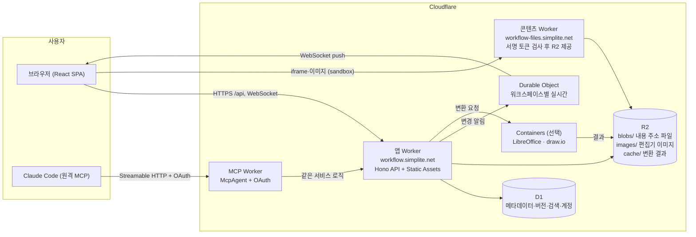
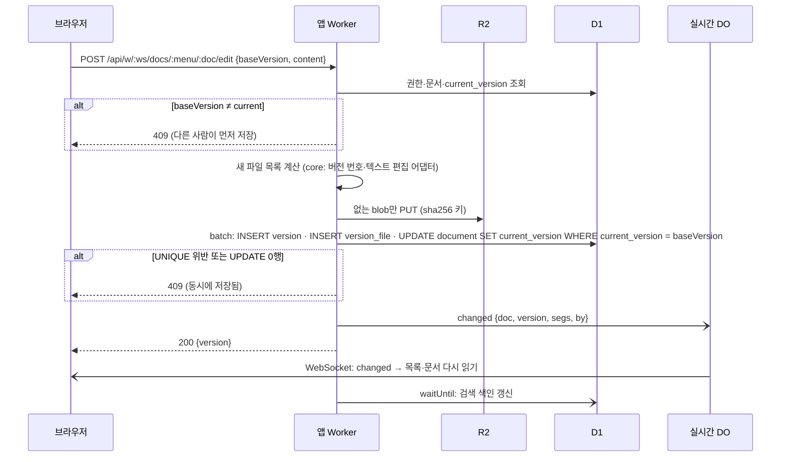
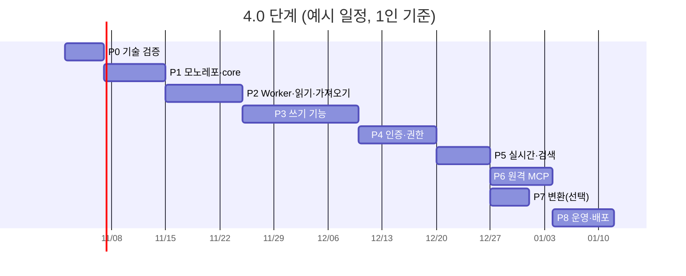

# 4.0 요구사항(설계): 업무 문서 사이트를 Cloudflare SaaS로 — 「문서 탐색 워크플로우」

지금 사이트(`site/`)는 한 사람의 컴퓨터에서 도는 로컬 앱이다. 원본은 리포의 `docs/` 파일이고, Fastify 서버가 파일을 감시하며 SQLite 색인을 다시 만든다. 4.0에서는 이 사이트를 **Cloudflare 위의 팀용 SaaS**로 옮긴다. 화면과 기능(메뉴·문서·버전, Markdown 편집, 텍스트 편집 2.0, MCP 3.0)은 그대로 두고, 저장소와 서버를 Cloudflare 서비스로 바꾼다.

> 상태: **v0.2** (2026-10-28). 서비스 이름 **문서 탐색 워크플로우**, 도메인 `workflow.simplite.net`. D-37~D-46 확정(9절, 제안안 그대로). P0~P8 개발 완료(7절 각 단계 결과). 남은 것은 실제 배포(사용자 준비물: Workers Paid, Google OAuth 클라이언트, SUPERADMIN 이메일, 배포 승인)와 P9.
>
> 주소: 앱·API·MCP `https://workflow.simplite.net`(MCP는 `/mcp`), 사용자 콘텐츠 `https://workflow-files.simplite.net`. 콘텐츠 도메인을 `files.workflow.simplite.net`(2단계 하위 도메인)로 하지 않는 이유는 Cloudflare 기본 인증서(Universal SSL)가 `*.simplite.net` 한 단계만 덮기 때문이다.

---

## 1. 목표와 범위

| 구분 | 내용 |
|---|---|
| 목표 | 여러 팀이 브라우저로 들어와 각자의 워크스페이스에서 설계 문서를 올리고, 보고, 고치고, 버전을 쌓는다. Claude Code는 원격 MCP로 붙는다 |
| 지킬 것 | 메뉴 → 문서 → 버전 구조, 버전 규칙(v0.0=draft, 수정마다 v0.x, 확정 vN.0, 기존 버전 불변), 확인 창, 하위 문서·폴더 트리, 텍스트 편집 2.0의 "원본 구간만 교체" 원칙, 참조 주소(`?seg=`) |
| 바뀌는 것 | 원본 위치(리포 `docs/` → D1 + R2), 서버(Fastify → Workers), 실시간(파일 감시 + SSE → Durable Object WebSocket), 로그인과 권한(없음 → 계정·워크스페이스·역할), MCP(로컬 stdio → 원격 HTTP) |
| 1차 범위 밖 | 결제·요금제, 공개 가입 마케팅 화면, Notion·Google Drive 자동 등록(지금처럼 사람이 확인하고 하는 작업으로 남김), 모바일 앱 |

## 2. 현재 시스템 분석

### 2.1 규모

| 영역 | 파일 | 줄 수(대략) | 비고 |
|---|---|---|---|
| 서버 `site/server/` | index·store·manage·scan·docpath·sitefiles·convert·schema | 1,500 | Fastify 라우트 30여 개, 파일 시스템 직접 사용 |
| 텍스트 편집 `server/textedit/` | html·ooxml·xlsx·svg·types | 800 | parse5·htmlparser2·fflate. **순수 JS라 Workers에서 그대로 돈다** (`node:crypto` 하나만 Web Crypto로 바꾸면 된다) |
| MCP `site/mcp/server.ts` | 1 | 400 | REST API를 감싼 stdio 서버 |
| 화면 `site/web/src/` | 컴포넌트·뷰어·편집기 | 5,300 | React 19 + Vite + Tailwind 4 + React Router + TanStack Query. 서버 의존은 `lib/api.ts`·`lib/manage.ts`와 SSE뿐 |
| 이미지 업로드 `site/cloudflare/r2-uploader/` | Worker 1 | — | 이미 Cloudflare에 배포됨(인증 없음) |
| 테스트 `site/test/` | node:test + puppeteer | 201건 | 임시 docs와 빈 포트로 서버를 따로 띄운다 |

### 2.2 Cloudflare로 옮길 때 걸리는 곳

| 지금 | Cloudflare에서의 문제 | 대응 |
|---|---|---|
| Fastify(Node 서버) | Workers는 상주 서버가 아니라 요청마다 실행된다 | **Hono**로 라우트를 옮긴다. 핸들러 로직은 거의 그대로 |
| `node:fs`로 `docs/` 읽고 쓰기 | Workers에는 파일 시스템이 없다 | 메타데이터는 **D1**, 파일 본문은 **R2**. `store.ts`·`manage.ts`의 파일 조작을 저장소 인터페이스 뒤로 숨긴다 |
| `meta.yaml`·`menus.yaml`이 원본, SQLite는 매번 다시 만드는 색인 | 색인을 매번 다시 만들 수 없다. 원본이 하나여야 한다 | **D1이 원본**. yaml은 가져오기·내보내기 형식으로만 남긴다(D-38). 스키마가 영구가 되므로 마이그레이션(drizzle-kit)이 생긴다 |
| 버전 폴더 복사(`cpSync`) | 새 버전마다 파일을 모두 복사하면 R2 용량·쓰기 횟수가 늘어난다 | **내용 주소(sha256) 저장**. 같은 내용은 R2에 한 번만 두고, 버전은 파일 목록 행만 새로 만든다 |
| chokidar 감시 + SSE | 감시할 파일이 없다. Worker 요청은 오래 열어 두기 어렵다 | 쓰기 API가 끝날 때 **워크스페이스별 Durable Object**에 알리고, DO가 WebSocket(Hibernation)으로 열린 화면에 보낸다 |
| `soffice`·`drawio` 변환 | Workers에서 실행 파일을 돌릴 수 없다 | **Cloudflare Containers**(Workers Paid 전용)에 LibreOffice·draw.io 내보내기 이미지를 올리고 결과를 R2에 캐시한다. 안 켜면 지금처럼 변환 기능만 빠진다(D-42) |
| `/files/<메뉴>/<문서>/<버전>/<파일>`을 같은 출처로 제공 | 여러 사람이 올린 HTML을 앱과 같은 출처로 주면 다른 사용자의 세션을 노릴 수 있다 | **사용자 콘텐츠 전용 도메인**에서 제공하고, 경로에 짧게 유효한 서명 토큰을 넣는다(5.5) |
| 인증 없음(127.0.0.1) | SaaS는 계정·권한이 있어야 한다 | 로그인 + 워크스페이스 + 역할(owner·editor·viewer) (D-39) |
| MCP stdio가 로컬 API 호출 | 원격 서버라 로컬 프로세스가 필요 없다 | **원격 MCP**(Streamable HTTP + OAuth). 도구 목록은 그대로 (D-44) |
| SQLite FTS5 trigram 검색 | — | D1도 FTS5를 쓴다. trigram 토크나이저는 P0에서 확인한다 |
| localStorage에 Worker 주소 | 사용자가 업로드 서버를 따로 설정 | 앱 Worker가 R2에 바로 올리므로 설정 창이 필요 없다 |

## 3. 기술 스택

| 층 | 선택 | 이유 |
|---|---|---|
| 화면 | 지금 그대로: React 19 · Vite · Tailwind 4 · React Router · TanStack Query · CodeMirror 6 · unified | 이미 만든 5,300줄을 그대로 쓴다. 바꾸는 곳은 API 주소(워크스페이스 경로), SSE → WebSocket, 로그인 화면 |
| 화면 배포 | **Workers Static Assets**(SPA 모드) + `@cloudflare/vite-plugin` | API Worker와 한 배포 단위. Pages 대신 Workers로 통일(Cloudflare가 Pages 기능을 Workers로 모으는 중) |
| API | **Hono** on Workers + zod | 가볍고 Workers 표준. Fastify 라우트와 모양이 비슷해 옮기기 쉽다 |
| DB | **D1**(SQLite) + **drizzle-orm**(`drizzle-orm/d1`) + drizzle-kit 마이그레이션 | 사용자가 정한 무료 DB. 지금도 drizzle·SQLite라 스키마를 거의 그대로 쓴다 |
| 파일 | **R2**(내용 주소 저장) | 사용자가 정한 저장소. 나가는 트래픽 무료 |
| 실시간 | **Durable Objects**(SQLite 백엔드, WebSocket Hibernation) | 무료 요금제에서도 쓸 수 있다. 잠든 연결은 시간 요금이 없다 |
| 인증 | **Better Auth**(D1 저장, Google·GitHub OAuth) — 또는 Cloudflare Access | D-39에서 정한다 |
| 변환 | **Cloudflare Containers**(LibreOffice, draw.io export) — 선택 | Workers Paid 전용. 없으면 변환만 빠진다 |
| 원격 MCP | **`agents` SDK의 McpAgent** + `@cloudflare/workers-oauth-provider` | Cloudflare 공식 원격 MCP 구성. Claude Code에 URL로 붙인다 |
| 비동기 작업 | `ctx.waitUntil` (필요해지면 Queues) | 검색 색인 갱신, 변환 미리 만들기 |
| 공통 로직 | **`packages/core`**(런타임 무관 TypeScript) | 텍스트 편집 어댑터, 버전 규칙, slug, 문서 트리, seg 해석을 화면·Worker·로컬 도구가 함께 쓴다 |
| 테스트 | **Vitest + `@cloudflare/vitest-pool-workers`**(D1·R2·DO를 로컬 Miniflare로) + 기존 puppeteer 화면 테스트(`wrangler dev` 대상) | 지금의 TC 케이스 ID를 그대로 옮긴다 |
| 배포 | wrangler + GitHub Actions(PR 미리보기, develop → staging, main → production) | 리포의 브랜치 모델과 맞춘다 |

## 4. 전체 아키텍처



- Worker 세 개로 나눈 이유: 앱(쿠키 세션)과 사용자 콘텐츠(서명 토큰)는 **출처가 달라야** 하고, MCP는 OAuth 흐름이 따로 있다. 셋은 같은 `packages/core`와 서비스 계층을 쓴다. 처음에는 앱과 MCP를 한 Worker에 두고 경로로 나눠도 된다.
- 지금 쓰는 이미지 업로드 Worker(`workflow-r2-uploader`)는 앱 Worker의 `POST /api/w/:ws/images`로 합치고, 인증을 붙인다.

## 5. 시스템 디자인

### 5.1 테넌시

- **워크스페이스**(팀)가 데이터의 경계다. 모든 테이블에 `workspace_id`가 있고, 모든 쿼리는 서비스 계층에서 `workspace_id` 조건을 강제한다.
- **D1 하나에 모든 워크스페이스**를 둔다(D-40). 무료 요금제는 DB가 10개뿐이라 워크스페이스마다 DB를 둘 수 없다. 한 DB의 최대 크기(무료 500MB, Paid 10GB)는 메타데이터만 담으므로 충분하다(본문은 R2).
- 주소: `https://workflow.simplite.net/<워크스페이스>/<대분류>/<메뉴>/<문서>?v=&seg=`. 지금 주소 앞에 워크스페이스만 붙는다. MCP 참조 주소 해석(`parseSeg`, 주소 → 문서)도 이 모양을 받는다.

### 5.2 데이터 모델 (D1)

지금 색인 테이블(`site/server/schema.ts`)을 원본 테이블로 바꾸고, `workspace_id`와 id 기반 관계를 넣는다. slug는 화면 주소용으로 그대로 둔다.

```sql
-- 계정 (Better Auth가 user·session·account·verification 테이블을 만든다)
CREATE TABLE workspace (id TEXT PRIMARY KEY, slug TEXT UNIQUE NOT NULL, name TEXT NOT NULL,
  created_at TEXT NOT NULL, plan TEXT NOT NULL DEFAULT 'free');
CREATE TABLE member (workspace_id TEXT NOT NULL REFERENCES workspace(id), user_id TEXT NOT NULL,
  role TEXT NOT NULL CHECK (role IN ('owner','editor','viewer')), PRIMARY KEY (workspace_id, user_id));
CREATE TABLE invite (id TEXT PRIMARY KEY, workspace_id TEXT NOT NULL, email TEXT NOT NULL, role TEXT NOT NULL,
  token_hash TEXT NOT NULL, expires_at TEXT NOT NULL);

-- 상단 메뉴(대분류)·좌측 메뉴(폴더) — 지금 categories.yaml·menus.yaml
CREATE TABLE top_menu (workspace_id TEXT NOT NULL, key TEXT NOT NULL, name TEXT NOT NULL, sort INTEGER NOT NULL,
  PRIMARY KEY (workspace_id, key));
CREATE TABLE menu (id TEXT PRIMARY KEY, workspace_id TEXT NOT NULL, slug TEXT NOT NULL, category_key TEXT NOT NULL,
  parent_id TEXT REFERENCES menu(id), name TEXT NOT NULL, sort INTEGER NOT NULL, UNIQUE (workspace_id, slug));

-- 문서 — 지금 meta.yaml. 하위 문서는 parent_id(같은 메뉴). slug는 메뉴 안에서 하나(D-34 그대로)
CREATE TABLE document (id TEXT PRIMARY KEY, workspace_id TEXT NOT NULL, menu_id TEXT NOT NULL REFERENCES menu(id),
  slug TEXT NOT NULL, parent_id TEXT REFERENCES document(id), sort INTEGER,
  title TEXT NOT NULL, kind TEXT NOT NULL, type TEXT, sdlc TEXT, status TEXT NOT NULL,
  current_version TEXT NOT NULL, notion_url TEXT, gdrive_url TEXT, origin_url TEXT,
  deleted_at TEXT, deleted_by TEXT,                -- 휴지통(지금 docs/_trash/ 폴더 이동)
  UNIQUE (menu_id, slug));

-- 버전 — 지금 meta.yaml versions[] + 버전 폴더
CREATE TABLE document_version (id TEXT PRIMARY KEY, document_id TEXT NOT NULL REFERENCES document(id),
  version TEXT NOT NULL, note TEXT, source TEXT NOT NULL, created_at TEXT NOT NULL, created_by TEXT,
  entry TEXT NOT NULL, UNIQUE (document_id, version));   -- UNIQUE가 동시 저장 충돌을 막는다(5.4)
CREATE TABLE version_file (version_id TEXT NOT NULL REFERENCES document_version(id), path TEXT NOT NULL,
  sha256 TEXT NOT NULL, size INTEGER NOT NULL, mime TEXT NOT NULL, PRIMARY KEY (version_id, path));

-- R2 blob 참조 수 — 영구 삭제 때 아무 버전도 안 쓰는 blob만 지운다
CREATE TABLE blob (workspace_id TEXT NOT NULL, sha256 TEXT NOT NULL, size INTEGER NOT NULL, refs INTEGER NOT NULL,
  PRIMARY KEY (workspace_id, sha256));

-- 검색 (지금과 같은 trigram. 최신 버전 대표 파일 본문)
CREATE VIRTUAL TABLE search USING fts5(workspace_id UNINDEXED, document_id UNINDEXED, title, body, tokenize = 'trigram');

-- 감사 기록 (누가 언제 무엇을)
CREATE TABLE activity (id INTEGER PRIMARY KEY AUTOINCREMENT, workspace_id TEXT NOT NULL, actor TEXT NOT NULL,
  agent TEXT, action TEXT NOT NULL, target TEXT NOT NULL, detail TEXT, at TEXT NOT NULL);
```

- 정렬 규칙(order → 제목 코드값 순), slug 자동(D-35), 하위로 옮길 때 자기·하위 금지, 다른 메뉴로 옮길 때 slug 충돌 처리(`-2`, 409)는 `manage.ts`의 규칙을 그대로 SQL로 옮긴다.
- D1의 한 행 최대 크기는 2MB다. 문서 본문은 D1에 넣지 않는다(검색 본문은 앞부분만 잘라 넣는다).

### 5.3 R2 키 설계

| 키 | 내용 |
|---|---|
| `ws/<workspace_id>/blobs/<sha256>` | 문서 파일 본문. **내용이 같으면 한 번만 저장**. 새 버전은 `version_file` 행만 추가한다 |
| `ws/<workspace_id>/images/<날짜>-<uuid>.<확장자>` | Markdown 편집기 이미지(지금 `markflow-images` 버킷의 `images/`) |
| `ws/<workspace_id>/cache/<변환종류>/<sha256>` | PDF·SVG 변환 결과(지금 `site/data/cache/`) |
| `ws/<workspace_id>/exports/<시각>.zip` | 워크스페이스 내보내기(지금 리포 `docs/`와 같은 폴더·yaml 구조) |

- 버전 불변 원칙이 저장 구조에서 저절로 지켜진다. 이미 있는 blob은 다시 쓰지 않고, 버전 행은 고치지 않는다.
- "직전 버전과 같으면 409"는 파일 목록과 sha256 비교로 지금과 같이 한다.

### 5.4 쓰기 흐름과 동시성



- D1 `batch()`는 한 트랜잭션으로 실행된다. `UNIQUE (document_id, version)`과 `WHERE current_version = baseVersion` 조건이 지금의 "기준 버전이 최신이 아니면 409"를 DB 수준에서 보장한다.
- R2에 먼저 쓰고 D1에 나중에 쓰므로, 실패해도 남는 것은 참조되지 않은 blob뿐이다. 매일 정리 작업(Cron Trigger)이 `blob.refs = 0`이고 오래된 것을 지운다.

### 5.5 문서 파일 제공과 보안

- HTML 문서는 지금처럼 iframe(sandbox, `allow-same-origin` 없음)으로 열고, **파일은 `workflow-files.simplite.net`에서** 준다. 앱과 출처가 달라서 문서 안 스크립트가 앱 쿠키나 API에 닿지 못한다.
- 두 도메인은 같은 사이트(`simplite.net`)라 `SameSite` 쿠키만으로는 막히지 않는다. 그래서 앱 쿠키는 `Domain` 없이(호스트 한정) 굽고, 상태를 바꾸는 API는 `Origin` 헤더가 앱 주소일 때만 받는다(CSRF 방어).
- 주소: `https://workflow-files.simplite.net/t/<토큰>/<메뉴>/<문서>/<버전>/<경로>`. 토큰은 HMAC(워크스페이스, 문서, 버전, 만료)이고 짧게 유효하다. 토큰이 경로 앞에 있어서 **HTML 안의 상대 경로 리소스와 링크가 지금처럼 그대로 동작한다**.
- 콘텐츠 Worker는 토큰을 검사하고 `version_file`에서 sha256을 찾아 R2 객체를 스트리밍한다. 응답에 `Content-Security-Policy: sandbox`와 `X-Content-Type-Options: nosniff`를 붙인다.
- 외부 출처 문서(3.3, D-25·D-27)의 "스크립트 켜기"는 그대로 둔다. 콘텐츠 도메인이 분리되어 있으므로 켜도 앱에는 닿지 않는다.
- 편집 사본(`edit-view`, 3.2 참조 보기)은 앱이 만들어 같은 방식으로 준다.

### 5.6 실시간

- 워크스페이스마다 Durable Object 하나(`idFromName(workspace_id)`). 화면은 `wss://workflow.simplite.net/api/w/:ws/live`로 붙고, Worker가 세션을 확인한 뒤 DO로 넘긴다.
- 쓰기 API는 끝날 때 DO에 `changed`·`focus` 이벤트를 보낸다. 이벤트 모양은 지금 SSE와 같다(`by`, 대분류·메뉴·문서·제목·버전·`segs`). 그래서 `LiveNotice`·`useLiveUpdates`는 연결 부분만 바꾼다.
- WebSocket Hibernation API로 쉬는 연결은 시간 요금이 없다. 지금의 "뒤로 가기 캐시에서 연결을 닫고 다시 연다" 처리(TC-UI-13)는 그대로 필요하다.

### 5.7 검색

- 쓰기가 끝나면 `waitUntil`로 최신 버전 대표 파일의 글자를 뽑아 `search`를 갱신한다. HTML에서 script·style·svg를 빼는 지금 규칙을 `core`로 옮긴다.
- 질의는 지금처럼 trigram 색인 위의 `LIKE '%q%'`에 `workspace_id` 조건을 붙인다. 제목에 맞은 문서를 먼저 보여 준다.
- trigram이 D1에서 안 되면 대안은 두 가지다. 하나는 기본 토크나이저에 2·3글자 n-gram을 직접 넣는 방식이고, 다른 하나는 문서가 적을 때 본문 `LIKE` 전체 검색이다(P0에서 결정).

### 5.8 텍스트 편집·변환

- `server/textedit/` 어댑터(HTML·DOCX·PPTX·XLSX·SVG)는 `packages/core`로 옮긴다. `createHash`는 Web Crypto `crypto.subtle.digest`로 바꾼다. 비동기가 되므로 해시 함수 이름만 async로 바꾼다.
- **CPU 시간이 관건이다.** 무료 Workers는 요청당 CPU 10ms라 DOCX·PPTX zip을 풀고 다시 묶기에 부족하다. Workers Paid(기본 30초, 최대 5분)가 필요하다(D-37).
- PPTX·DOCX → PDF와 draw.io → SVG는 Containers에서 돌린다. 결과는 원본 sha256 키로 R2 `cache/`에 둔다(지금 캐시 규칙과 같다). 한글 글꼴(Noto Sans KR·IBM Plex Sans KR)을 이미지에 넣는다. 지금 macOS에서 겪은 "한글 빠진 PDF" 문제가 컨테이너에서도 생기지 않게 하기 위해서다.
- DOCX는 지금처럼 화면의 docx-preview로 그리므로 변환 없이도 볼 수 있다.

### 5.9 인증과 권한

| 역할 | 보기 | 업로드·편집·옮기기 | 휴지통·복원 | 영구 삭제·폴더 삭제·대분류 관리 | 멤버·초대 |
|---|---|---|---|---|---|
| viewer | ○ | | | | |
| editor | ○ | ○ | ○ | | |
| owner | ○ | ○ | ○ | ○ | ○ |

- 앱은 세션 쿠키(Better Auth, `SameSite=Lax`, `HttpOnly`)를 쓴다. MCP는 OAuth 액세스 토큰을 쓴다. 둘 다 서비스 계층에서 같은 `(user, workspace, role)` 검사를 거친다.
- 지금의 `X-Workflow-Agent: claude-code` 헤더는 MCP 토큰으로 대신한다. 토큰에서 "Claude Code가 한 일"을 알 수 있고, `activity.agent`와 실시간 알림의 `by`에 남긴다.

### 5.10 원격 MCP

- 도구는 지금과 같다: `list_documents`, `find_documents`, `get_document`, `get_text`, `edit_text`, `save_markdown`, `upload_document`, `upload_version`, `create_menu`, `release_document`, `focus_in_site`. 삭제 도구는 두지 않는다(D-24). 변경 메모 앞의 "Claude Code:"(D-26)도 그대로 둔다.
- **바뀌는 점은 로컬 파일 업로드다.** 원격 서버는 사용자 컴퓨터의 파일을 읽을 수 없다. `upload_document`·`upload_version`은 파일 내용(base64, 크기 제한)을 받는다. 큰 파일과 폴더는 로컬 보조 CLI(`npx workflow-docs upload <경로>`)가 API로 올린다.
- 연결: `claude mcp add --transport http workflow-docs https://workflow.simplite.net/mcp` → 처음 쓸 때 브라우저로 OAuth 로그인한다.

### 5.11 API

지금 경로 앞에 `/api/w/:ws`를 붙이고, 의미는 그대로 둔다.

| 지금 | 4.0 |
|---|---|
| `GET /api/tree` | `GET /api/w/:ws/tree` |
| `GET /api/docs/:menu/:doc` | `GET /api/w/:ws/docs/:menu/:doc` (파일 주소는 서명된 usercontent 주소로 돌려준다) |
| `POST /api/upload`(multipart) | 같은 모양. 요청 본문은 100MB가 한도다. 파일 하나 25MB, 압축을 푼 합계 100MB로 제한한다 |
| 편집·텍스트 편집·미리보기·확정·관리·휴지통·검색 | 같은 모양 |
| `GET /api/events`(SSE) | `GET /api/w/:ws/live`(WebSocket) |
| `POST /api/reindex` | 없앤다(원본이 DB). 대신 owner용 `POST /api/w/:ws/search/rebuild` |
| `/files/...` | `usercontent` 도메인 |
| `GET /api/convert/:to/...` | `GET /api/w/:ws/convert/:to/:sha256` (Containers 켠 경우) |
| — 새로 | `/api/auth/*`(Better Auth), `/api/workspaces`, `/api/w/:ws/members`, `/api/w/:ws/invites`, `/api/w/:ws/images`, `/api/w/:ws/import`, `/api/w/:ws/export` |

### 5.12 한도와 요금 (2026-10 Cloudflare 문서 기준)

| 항목 | 무료 | Workers Paid($5/월) | 이 서비스에서 |
|---|---|---|---|
| Workers CPU/요청 | **10ms** | 30초(최대 5분) | 텍스트 편집·zip 업로드는 무료로는 부족 → **Paid 필요** |
| Workers 요청 | 10만/일 | 1천만/월 포함 | 팀 몇 개면 무료로도 충분 |
| 요청 본문 | 100MB | 100MB | 업로드 한도 |
| D1 DB 크기 / 계정 합계 | 500MB / 5GB | 10GB / 1TB | 메타데이터만이라 충분 |
| D1 쿼리/요청 | 50 | 1,000 | 트리 조회·옮기기는 batch로 묶는다 |
| D1 읽기·쓰기 | 일 500만 행 읽기·10만 행 쓰기 | 월 250억 읽기·5천만 쓰기 포함 | 검색 색인 갱신이 쓰기를 가장 많이 쓴다 |
| R2 | 월 10GB, 쓰기 100만·읽기 1천만 회, 나가는 트래픽 무료 | 같은 무료분 + 사용량 과금 | 내용 주소 저장으로 중복을 줄인다 |
| Durable Objects | SQLite 백엔드만, 일 10만 요청 | 포함분 + 사용량 | Hibernation으로 쉬는 연결은 시간 요금 없음 |
| Containers | 없음 | 사용량 과금 | 변환을 켤 때만 |

> D1·R2는 사용자 요구대로 무료 범위로 쓴다. 다만 **Worker 실행은 Paid가 사실상 필요**하다(D-37). 요금제와 한도는 P0에서 다시 확인한다.

## 6. 리포 구조

```
workflow/
  apps/
    web/                 # 지금 site/web → API 주소·실시간·로그인만 바뀜
    worker/              # Hono 앱 Worker: routes/ services/ db/(drizzle schema·migrations) live/(DO)
    usercontent/         # 콘텐츠 Worker(서명 토큰 → R2)
    mcp/                 # 원격 MCP(McpAgent + OAuth). 처음엔 worker 안의 경로로 둬도 된다
    converter/           # Containers 이미지(Dockerfile: LibreOffice, draw.io export, 한글 글꼴) — 선택
  packages/
    core/                # textedit 어댑터, 버전 규칙(nextVersion·versionLabel·release), slug, docTree, seg 해석, 검색 글자 추출, yaml 가져오기·내보내기
    cli/                 # 가져오기(docs/ → 워크스페이스), 내보내기, 큰 파일 업로드
  site/                  # 지금 로컬 사이트. 전환 기간 동안 유지, core를 쓰도록 바꾼 뒤 P8에서 정리
  docs/                  # 지금 문서 원본. 가져오기 뒤에는 내보내기 백업 위치(D-38)
```

## 7. 단계 계획

크기: S(며칠) · M(1~2주) · L(2~3주). 각 단계는 develop에 PR로 들어가고, 단계마다 완료 기준을 자동 테스트로 확인한다. `TESTING.md`에 새 케이스 ID(`TC-CF-…`)를 더한다.

### P0. 기술 검증 (S)

막힐 수 있는 곳만 먼저 작은 Worker로 확인한다.

| 확인 | 방법 | 통과 기준 |
|---|---|---|
| D1 FTS5 trigram | `wrangler d1` 원격 DB에 지금 DDL을 만들고 한국어 2·3글자 질의 | 지금 `TC-SEARCH` 케이스와 같은 결과 |
| 텍스트 편집 CPU | `scripts/fixtures`의 DOCX·PPTX·XLSX·SVG를 Worker에서 조각 뽑기·저장 | Paid에서 요청당 CPU 1초 이하. 무료 10ms 안에 되는지도 기록 |
| WebSocket DO | 두 브라우저에서 변경 알림 | Hibernation 뒤에도 알림 도착 |
| Better Auth on D1 | Google 로그인 → 세션 쿠키 | 로그인·로그아웃·세션 만료 |
| 콘텐츠 도메인 | 서명 토큰 경로로 HTML + 상대 경로 이미지 | iframe 안 상대 링크·리소스 동작 |
| Containers(선택) | LibreOffice 이미지로 sample.pptx → PDF | 한글 글꼴 포함, 응답 시간 기록 |

**산출물**: 검증 보고(이 문서 8절 갱신), D-37~D-46 확정.

**P0 결과 (2026-10-28)**

| 확인 | 결과 |
|---|---|
| D1 FTS5 trigram | **원격 D1에서 동작.** `tokenize='trigram'` 표를 만들고 한국어 질의 `LIKE '%q%'` 결과가 맞다(리뷰·리뷰를·스프린트·에이전트가·머지·Git-flow). 3글자 이상은 색인(읽은 행 2~5), 2글자는 전체 훑기(읽은 행 7~8)로 결과는 맞다. 시험용 DB는 지웠다 |
| 텍스트 편집 CPU | 로컬 Node 측정(Workers도 V8이라 비슷하다): DOCX 7KB 조각 뽑기 7~15ms·저장 14ms, PPTX 84KB(780조각) 8~15ms·21ms, draw.io SVG 148KB 11~26ms, HTML 108KB(1,220조각) 30~52ms. **무료 10ms를 넘는다 → Workers Paid 필요(D-37 확인)** |
| WebSocket DO · Better Auth · 콘텐츠 도메인 · Containers | 별도 실험 대신 해당 단계(P2·P4·P5·P7)에서 Miniflare 자동 테스트로 확인한다 |

### P1. 모노레포와 core 분리 (M)

- npm workspaces로 `apps/`·`packages/` 구조를 만든다. `site/server/textedit/`, 버전 규칙, slug, `docTree`, `seg`, 검색 글자 추출을 `packages/core`로 옮긴다. `node:*` 의존을 없앤다(Web Crypto, 경로 처리는 문자열 함수).
- 지금 로컬 사이트가 core를 쓰도록 바꾼다. **기능 변화 없음.**
- 완료: `npm test`(201건) 전부 통과, `npm run check:textedit` 바이트 동일 검사 통과, core가 Workers 타입(`@cloudflare/workers-types`)으로 타입 검사 통과.

**P1 결과 (2026-10-28)**: 리포 루트 npm workspaces(`packages/*` · `apps/*` · `site`). `packages/core`(`@workflow/core`)에 텍스트 편집 어댑터(`site/server/textedit/`에서 옮김), 버전 규칙, slug, 조각 참조, MIME, 검색 본문, 업로드 규칙(경로 정리·zip·대표 파일·kind·작성 시각)을 모았다. `node:crypto`는 `@noble/hashes`(동기 sha256)로 바꿔 어댑터 API를 그대로 두었다. 로컬 사이트(서버·화면·MCP)는 core를 쓰고, 테스트 201건·`check:textedit` 모두 그대로 통과.

### P2. Worker 골격 + 읽기 + 가져오기 (M)

- `apps/worker`: Hono, D1 스키마·마이그레이션(5.2), R2 blob 저장소, 서비스 계층(`TreeService`·`DocService`)을 만든다.
- 읽기 API: tree·문서·파일 목록. 콘텐츠 Worker와 서명 토큰도 만든다.
- `packages/cli import`: 리포 `docs/`(categories·menus·meta.yaml·버전 폴더·하위 문서)를 워크스페이스로 옮긴다. sha256이 같은 파일은 한 번만 올린다.
- 화면: API 주소를 `/api/w/:ws`로 바꾸고 Static Assets로 배포한다. 로그인 없이 개발용 워크스페이스 하나로 읽기 전용으로 띄운다.
- 완료: 지금 리포 `docs/`를 가져온 뒤 모든 문서가 `wrangler dev`에서 지금과 같이 보인다(HTML 상대 링크, 이미지, PDF, DOCX, XLSX, Markdown, draw.io SVG). 가져오기 → 내보내기 → 원본 `docs/`와 비교했을 때 차이가 없다.

**P2 결과 (2026-10-28)**
- `apps/worker`: Hono, 화면 정적 파일(Workers Static Assets, SPA), D1 마이그레이션 `migrations/0001_init.sql`, R2 내용 주소 저장. 한 Worker가 앱·콘텐츠 두 도메인을 호스트로 나눠 받는다(`FILES_ORIGIN`이 비면 로컬처럼 같은 출처의 `/c/`).
- 설계에서 바꾼 점: ① drizzle 대신 **D1 SQL을 직접** 쓴다(쿼리가 단순하고 마이그레이션 파일과 1:1). ② id는 문자열 대신 **정수 자동 증가**(화면 타입 `id: number`를 그대로 쓰기 위해). ③ 콘텐츠 토큰은 **워크스페이스 단위**(문서 사이 상대 링크가 같은 토큰으로 열려야 해서), 만료는 12시간 단위로 끊어 같은 창 안에서는 주소가 같다(캐시). 콘텐츠 경로는 로컬 `docs/` 폴더 구조와 같은 `메뉴/상위.../문서/버전/파일`.
- 가져오기: `packages/cli/src/import.ts`(가져오기 API: `POST /api/admin/workspaces` → `/w/:ws/site` → `/w/:ws/blobs/missing` → `PUT /w/:ws/blobs/:sha` → `/w/:ws/docs`, Bearer ADMIN_TOKEN).
- 화면: `VITE_CLOUD=1` 빌드(`apps/worker`의 `npm run build:web`)에서 라우터 basename과 API 앞부분이 워크스페이스(`web/src/lib/base.ts`). 로컬 사이트는 그대로.
- 확인: 실제 리포 `docs/`(문서 18개·파일 31개)를 `wrangler dev`로 가져와 **트리 응답이 로컬 서버와 같고, 18개 문서 상세가 모두 같고(id·주소 제외), 31개 파일을 서명 주소로 받아 sha256이 모두 같다.** 화면에서 HTML(iframe)·Markdown·SVG 문서가 열린다.

### P3. 쓰기 기능 (L)

- 업로드(파일·폴더·zip, 대표 파일 고르기, 다음 버전 번호, 직전과 같으면 409), Markdown 저장, 텍스트 편집·미리보기, 정식 확정, 관리(대분류·메뉴·문서 이름 바꾸기·옮기기·순서·하위 문서), 휴지통(소프트 삭제·복원·영구 삭제와 blob 참조 감소)을 옮긴다.
- 동시성은 5.4대로 처리한다. 편집기 이미지 업로드를 `POST /api/w/:ws/images`로 합치고, 편집기의 Worker 주소 설정 창은 없앤다.
- 완료: 지금 API 테스트(TC-UP·TC-EDIT·TC-TEAPI·TC-MNG·TC-TREE·TC-TRASH)를 Vitest + Miniflare로 옮겨 모두 통과한다. 화면 테스트(puppeteer)도 `wrangler dev` 대상으로 통과한다(실시간·인증 관련 제외).

**P3 결과 (2026-10-28)**
- Worker: 업로드(multipart·zip·폴더), Markdown 저장, 텍스트 편집(조각·편집 사본·미리보기·저장), 정식 확정, 관리(메뉴·대분류·문서 이름·이동·순서·하위 문서), 휴지통(소프트 삭제·복원·영구 삭제와 안 쓰는 blob 정리), 검색, 편집기 이미지(`POST /api/w/:ws/images` → `/i/<ws>/<이름>`, 토큰 없이 추측 불가 이름).
- 휴지통 모델: 문서와 하위 문서에 `deleted_at`·`trash_id`(= 지운 문서 id)·`trash_menu`. slug 고유성은 휴지통 밖 문서끼리만(부분 고유 색인), 메뉴가 지워지면 `menu_id`는 NULL. 복원은 메뉴 최상위로, 순서는 지우기 전 그대로(로컬과 같음).
- 새 버전 쓰기는 R2(없는 blob만) → D1 batch 한 번(버전·파일 행·current·검색). 확정과 편집은 R2 복사 없이 같은 blob을 가리킨다.
- 화면: 편집기 이미지 올리기는 Cloudflare에서 앱 API로 바로(설정 버튼 숨김). Markdown 상대 경로는 콘텐츠 전체 주소 기준, `[[` 문서 링크는 렌더링할 때 워크스페이스를 붙인다.
- 아직 안 되는 것: PDF·SVG 변환(PPTX 미리보기, draw.io 보기, `text-preview?to=pdf`는 501) → P7. 실시간 반영·focus → P5.
- 테스트: Worker 28건(TESTING.md 2.7 TC-CF-01~29, 로컬 API 케이스를 같은 규칙으로 옮김), Cloudflare 화면 5건(TC-CFUI-01~05). 로컬 사이트 201건도 그대로 통과.

### P4. 인증·워크스페이스·권한 (M)

- Better Auth(D-39), 워크스페이스 만들기, 초대(링크·이메일), 역할(5.9)을 넣는다. 서비스 계층 모든 함수가 `(user, ws, role)`을 받는다.
- 화면: 로그인, 워크스페이스 고르기·만들기, 멤버 관리, 역할에 따라 버튼 숨김·비활성.
- 완료: 권한 표의 칸마다 허용·거부 테스트가 있다. 다른 워크스페이스 id로 직접 호출하면 404가 난다. 콘텐츠 토큰은 위조·만료·다른 워크스페이스 재사용이 모두 거부된다.

**P4 결과 (2026-10-28)**
- 결정(2026-10-28, 사용자): **Google 로그인만, 초대받은 사람만(SUPERADMIN_EMAILS 예외), 초대는 링크 복사**. 그래서 Better Auth 대신 Google OIDC(인가 코드 + PKCE)를 Worker에 직접 구현했다(로그인 수단이 하나라 라이브러리 설정보다 단순하고, Workers 테스트로 전부 확인된다).
- D1 `migrations/0002_auth.sql`: `app_user`, `session`(쿠키 토큰의 sha256, 30일), `member`(owner·editor·viewer), `invite`(링크 토큰의 sha256, 7일, 한 번, 이메일 지정 가능).
- Worker: `/api/auth/google`·`/google/callback`·`/logout`, 개발용 `/api/auth/dev-login`(DEV_LOGIN=1일 때만), `/api/me`, `POST /api/workspaces`(SUPERADMIN), `/api/invites/<토큰>`(초대 링크), `/api/w/:ws/members`·`/invites`. 워크스페이스 API 앞 미들웨어가 로그인·멤버·역할(5.9 표)을 검사하고, 상태를 바꾸는 API는 `Origin`이 앱 주소일 때만 받는다. 운영자용 `POST /api/admin/w/:ws/members`와 가져오기 CLI `--owner`로 첫 owner를 둔다.
- 쿠키: https에서는 `__Host-wf_session`(Secure·Path=/·Domain 없음), 로컬 http는 `wf_session`. 콘텐츠 도메인으로 쿠키가 가지 않는다.
- 화면: 로그인 화면(Google·개발용), 워크스페이스 없음 안내(SUPERADMIN은 새로 만들기), 헤더 계정 메뉴(워크스페이스 이동·멤버·로그아웃), 멤버·초대 창. viewer는 업로드·편집·폴더·대분류 관리 버튼이 숨고, 대분류 관리는 owner만 보인다(서버가 다시 검사).
- 운영 준비물(사용자): Google Cloud 콘솔에서 OAuth 클라이언트(웹)를 만들고 승인된 리디렉션 URI `https://workflow.simplite.net/api/auth/google/callback`(로컬 시험은 `http://127.0.0.1:8787/api/auth/google/callback`)을 넣은 뒤 Client ID·Secret을 준다. SUPERADMIN 이메일을 정한다.
- 테스트: Worker 36건(TC-CF-30~37 추가), 화면 7건(TC-CFUI-06·07 추가).

### P5. 실시간·검색·활동 기록 (M)

- 워크스페이스 DO, WebSocket 화면 연결, `changed`·`focus` 이벤트, Claude 실시간 표시(3.4)를 옮긴다. 쓰기 후 검색 색인을 갱신하고 `activity`를 남긴다.
- 완료: TC-LIVE·TC-UI-13(뒤로 가기 캐시)·TC-SEARCH가 통과한다. 두 사용자가 동시에 저장하면 한쪽이 409를 받고, 다른 쪽 화면에 알림이 뜬다.

**P5 결과 (2026-10-28)**
- 실시간: 워크스페이스마다 Durable Object `Live`(`src/live.ts`, SQLite 백엔드, WebSocket Hibernation, ping 자동 응답). 화면은 `/api/w/:ws/live`로 붙고(멤버만), 쓰기 API가 끝나면 워크스페이스 미들웨어가 알림을 보낸다. 알림 모양은 로컬 SSE와 같아 `LiveNotice`·`useLiveUpdates`는 연결만 바뀌었다(끊기면 1초부터 최대 30초까지 늘려 다시 붙고, 뒤로 가기 캐시에서는 닫았다 다시 연다).
- 알림은 `waitUntil` 대신 응답 전에 보낸다(DO 호출 하나 + D1 한 줄이라 짧고, 알림이 늦게 가거나 빠지는 일이 없다). 알림이 실패해도 저장은 성공으로 둔다.
- `POST /api/w/:ws/focus`(3.4 focus_in_site), 활동 기록 `activity`(`migrations/0003_activity.sql`, `GET /api/w/:ws/activity`).
- 검색은 P3에서 이미 옮겼다(TC-CF-28).
- 테스트: Worker 39건(TC-CF-38~40), 화면 8건(TC-CFUI-08).

### P6. 원격 MCP (M)

- McpAgent와 OAuth 제공자를 만들고 도구 11개를 옮긴다. 업로드는 base64 내용으로 받고, 보조 CLI를 만든다. 스킬 문서(`.claude/skills/workflow-docs/SKILL.md`)를 원격 연결 기준으로 고친다.
- 완료: TC-MCP를 원격 서버 대상으로 옮겨 통과한다. Claude Code에서 OAuth 로그인 → 문서 수정 → 열린 화면에 강조 표시가 뜬다.

**P6 결과 (2026-10-29)**
- 도구 정의를 `packages/mcp-tools`(`registerTools(server, host)`)로 옮겨 로컬 stdio 서버(`site/mcp/server.ts`, 파일 경로로 올림)와 원격 MCP(`apps/worker/src/mcp.ts`, 파일 내용 글자·base64로 올림, 20MB까지)가 함께 쓴다. 로컬 MCP 테스트 21건 그대로 통과.
- 원격: `@cloudflare/workers-oauth-provider`의 OAuthProvider가 Worker 진입점(`src/index.ts`)이다. `/mcp`(토큰 필요) → `mcp.ts`, `/oauth/token`·`/oauth/register`(동적 등록)·`/.well-known/*`은 라이브러리, `/authorize`는 동의 화면(`src/consent.ts`: 로그인 → 연결할 워크스페이스 고르기 → 허용). 토큰 props에 사용자·워크스페이스가 담기고, 도구는 같은 Worker의 앱 API를 그 사용자로 부른다(내부 서명 머리글 `x-wf-internal`, 60초). 그래서 권한(5.9)·실시간 알림(by: claude-code)·활동 기록이 화면과 같다.
- 설계에서 바꾼 점: `agents`의 McpAgent(Durable Object) 대신 MCP SDK의 `WebStandardStreamableHTTPServerTransport`를 상태 없이(JSON 응답) 쓴다. 도구가 모두 요청-응답이라 세션이 필요 없고, DO·의존성이 하나 줄었다. OAuth 상태는 KV `OAUTH_KV`.
- 연결: `claude mcp add --transport http workflow-docs https://workflow.simplite.net/mcp` → 처음 쓸 때 브라우저로 로그인·동의.
- 테스트: Worker 42건(TC-CF-41~43).

### P7. 변환 (S~M, 선택)

- `apps/converter`(LibreOffice·draw.io export·한글 글꼴)를 Containers로 만든다. Worker가 변환을 요청하고 결과를 R2 캐시에 둔다. 컨테이너가 꺼져 있거나 실패하면 지금처럼 "변환할 수 없음"을 보여 준다.
- 완료: TC-CONV·PPTX 미리보기(`text-preview?to=pdf`)가 통과하고, 한글이 빠지지 않는다.

**P7 결과 (2026-10-29)**
- `apps/converter`: Node(의존성 없음) + LibreOffice(impress·writer·calc) + Noto CJK 글꼴 이미지. `POST /convert?ext=` → PDF, 한 번에 하나씩. 로컬 Docker로 샘플 PPTX·DOCX를 바꿔 한글이 Noto Sans CJK로 들어간 것을 확인했다.
- Worker: Cloudflare Containers(`Converter`, `@cloudflare/containers`, 인스턴스 최대 2, 5분 쉬면 잠듦, 인터넷 차단). `GET /api/w/:ws/convert/pdf/<sha256>`(그 워크스페이스 파일만), `text-preview?to=pdf`(PPTX 편집 미리보기). 결과는 R2 `ws/<id>/cache/pdf/<sha256>`에 캐시. 컨테이너가 없는 환경은 501. `wrangler dev`(로컬 Docker)에서 첫 변환 5.7초, 캐시 25ms.
- **draw.io는 서버에서 바꾸지 않는다**: draw.io 데스크톱은 Electron·가상 화면이 필요해 이미지가 커서, Cloudflare 화면은 draw.io 공식 뷰어(viewer.diagrams.net)를 iframe으로 열고 XML을 주소의 `#R` 조각에 넣는다(조각은 그 서버로 전송되지 않지만, 뷰어 스크립트는 그 사이트 것이다. 외부 스크립트를 피해야 하면 다시 정한다). 로컬 사이트는 그대로 drawio CLI.
- 이 단계에서 찾아 고친 것(TESTING.md 5절): 콘텐츠 도메인 CORS(따로 띄운 운영 구성에서 글자 문서가 안 열릴 문제), Markdown 저장 직후 이동 경고.
- 테스트: Worker 43건(TC-CF-44), 화면 9건(TC-CFUI-09). 화면 테스트는 이제 앱·콘텐츠 출처를 나눠 띄운다.

### P8. 운영과 배포 (M)

- 환경: `dev`(로컬 Miniflare), `staging`(develop 브랜치), `production`(main 브랜치). 환경마다 D1·R2·DO를 따로 둔다.
- GitHub Actions: PR마다 테스트, develop 머지 → staging 배포(+ D1 마이그레이션), main 머지 → production 배포.
- 백업: D1 Time Travel(30일 되돌리기), 매일 워크스페이스 내보내기 zip을 R2 `exports/`에 둔다. 복구 절차를 문서로 남긴다.
- 관측: Workers Logs, 오류 알림. 요청 제한: 로그인·업로드·MCP에 rate limiting 바인딩을 건다.
- 도메인을 연결하고, 로컬 `site/`의 Fastify 서버는 정리한다(또는 오프라인용으로 남긴다. D-38).
- 완료: staging에서 전체 자동 테스트 통과. 백업에서 복구하는 리허설 1회. production 오픈.

**P8 결과 (2026-10-29)** — 배포 직전까지
- `wrangler.jsonc`: 로컬(맨 위) · `env.staging`(workers.dev, 콘텐츠 같은 출처) · `env.production`(`workflow.simplite.net`·`workflow-files.simplite.net` 사용자 지정 도메인). 환경마다 D1·KV·R2·DO·컨테이너·요청 제한을 따로 둔다. 실제 자원 id(`REPLACE_…`)는 처음 배포 때 채운다(`apps/worker/README.md` 절차). `wrangler deploy --dry-run --env production`으로 바인딩을 확인했다.
- 운영 기능: 매일 정리 Cron(`src/cleanup.ts`), 요청 수 제한(로그인 IP당 분당 20, 쓰기 분당 120), Workers Logs(`observability`), 워크스페이스 내보내기 zip(`GET /api/w/:ws/export`, owner) — 가져오기 CLI와 왕복된다(TC-CFUI-10).
- 백업: D1 Time Travel(30일) + R2 내용 주소(덮어쓰기 없음) + 내보내기 zip. 복구 절차는 `apps/worker/README.md`.
- CI: `.github/workflows/workflow-app.yml` — PR마다 타입 검사·로컬 사이트 테스트·Worker 테스트, develop 푸시 → staging, main 푸시 → production(D1 마이그레이션 + 화면 빌드 + 배포). 저장소 Secrets `CLOUDFLARE_API_TOKEN`·`CLOUDFLARE_ACCOUNT_ID`가 필요하다.
- 로컬 `site/` Fastify 사이트는 오프라인·문서 원본 편집용으로 남긴다(D-38: 리포 `docs/`는 가져오기 출처이자 내보내기 백업 위치).
- 테스트: Worker 46건(TC-CF-45~47), 화면 10건(TC-CFUI-10). 로컬 사이트 201건 그대로.

### P9. SaaS 마감 (이후)

- 공개 가입, 워크스페이스별 사용량 한도(저장 용량·문서 수), 요금제, 약관·개인정보 처리방침, 계정 삭제·데이터 내보내기. 범위는 P8 뒤에 다시 정한다.



## 8. 위험과 대응

| 위험 | 영향 | 대응 |
|---|---|---|
| 무료 Workers CPU 10ms | 텍스트 편집·zip 업로드·검색 색인이 실패 | Paid 사용(D-37). 무료로 가야 하면 텍스트 편집 결과 파일을 화면에서 만들어 올리고 서버는 검사만 하는 방식을 검토한다(보장 수준이 낮아진다) |
| D1 trigram 미지원 | 한국어 부분 검색 품질 저하 | 5.7의 대안 (P0에서 결정) |
| 사용자 HTML의 보안 | 다른 사용자 세션 탈취 | 콘텐츠 도메인 분리 + 서명 토큰 + sandbox CSP (5.5). 출시 전 보안 점검 |
| 원본이 git에서 DB로 이동 | 리뷰·이력 방식이 바뀐다. 지금 문서 규칙(커밋된 버전 폴더는 수정 금지 등)과 다르다 | 버전 불변은 DB 구조로 지킨다. 정기 내보내기로 git 백업을 남길 수 있다(D-38) |
| 업로드 크기 | 100MB 본문, 메모리 128MB | 파일 25MB·합계 100MB로 제한. 넘으면 R2 직접 업로드(서명 URL)를 P3 이후에 검토한다 |
| D1 쿼리 수 한도(무료 50/요청) | 트리 옮기기·순서 재작성이 많은 쿼리를 쓴다 | `batch()`로 묶는다. 순서 재작성은 한 번의 `UPDATE … CASE`로 한다 |
| 변환 컨테이너 비용·시작 지연 | PPTX 미리보기가 느리다 | 결과를 sha256으로 캐시하고, 업로드 직후 `waitUntil`로 미리 만든다 |

## 9. 결정 사항 (2026-10-28 확정: 제안안 그대로. 결제(Workers Paid)는 사용자가 계정에 추가)

| ID | 질문 | 제안 | 다른 선택지 |
|---|---|---|---|
| D-37 | Workers 요금제 | **Workers Paid($5/월)**. D1·R2는 포함 무료분 안에서 쓴다 | 무료(10ms CPU라 텍스트 편집·zip 업로드를 화면 쪽으로 옮겨야 한다) |
| D-38 | 문서 원본 | **D1 + R2가 원본**. 리포 `docs/`는 가져오기 출처이자 내보내기 백업 | git 원본을 유지하고 SaaS가 GitHub에 커밋(복잡하고 느리다) |
| D-39 | 로그인 | **Google 로그인만, 초대받은 사람만, 초대는 링크 복사**(2026-10-28 사용자 결정). 구현은 Better Auth 대신 Google OIDC 직접 구현(P4 결과) | Cloudflare Access, 이메일 링크 로그인, 공개 가입(P9에서 다시 본다) |
| D-40 | 테넌시 | **D1 하나 + `workspace_id`** | 워크스페이스마다 D1(무료는 DB 10개 제한) |
| D-41 | 사용자 콘텐츠 제공 | **별도 도메인 + 서명 토큰** | 같은 도메인 + sandbox만(보안 약함) |
| D-42 | 변환(PPTX·DOCX→PDF, draw.io→SVG) | **PDF는 Containers(LibreOffice), draw.io는 화면에서 draw.io 공식 뷰어**(P7 결과) | draw.io도 컨테이너로(이미지가 큼), 외부 변환 API |
| D-43 | 실시간 | **Durable Object WebSocket** | 주기적 다시 읽기(polling) |
| D-44 | MCP | **원격 MCP(OAuth)** + 큰 파일용 보조 CLI | 로컬 stdio 유지 + API 토큰 |
| D-45 | 서비스 도메인·이름 | **확정**: 「문서 탐색 워크플로우」, `workflow.simplite.net`(앱·API·MCP), `workflow-files.simplite.net`(사용자 콘텐츠) | — |
| D-46 | Notion·Google Drive 등록 | 지금처럼 Claude Code가 사용자 확인을 받고 하는 수동 작업으로 둔다(1차 범위 밖) | 앱 안 연동 기능 |

## 10. 참고

- Cloudflare 문서: [Workers 한도](https://developers.cloudflare.com/workers/platform/limits/) · [D1 한도](https://developers.cloudflare.com/d1/platform/limits/) · [Durable Objects 요금](https://developers.cloudflare.com/durable-objects/platform/pricing/) · [Containers](https://developers.cloudflare.com/containers/)
- D1 FTS5 사례: [FTS5 on Cloudflare D1 (한국어 검색)](https://dev.to/riversea/fts5-on-cloudflare-d1-cut-my-korean-keyword-search-from-220ms-to-22ms-heres-what-almost-broke-it-3l9p) · [Cloudflare D1 FTS (trigram)](https://zenn.dev/cybozu_frontend/articles/cloudflare-d1-fts)
- 지금 구조와 규칙: `.claude/CLAUDE.md`(지침)·`.claude/rules/`·`.claude/guides/`, `REQUIREMENT.md`(1.x), `REQUIREMENT-2.0.md`, `REQUIREMENT-3.0.md`, `TESTING.md`
