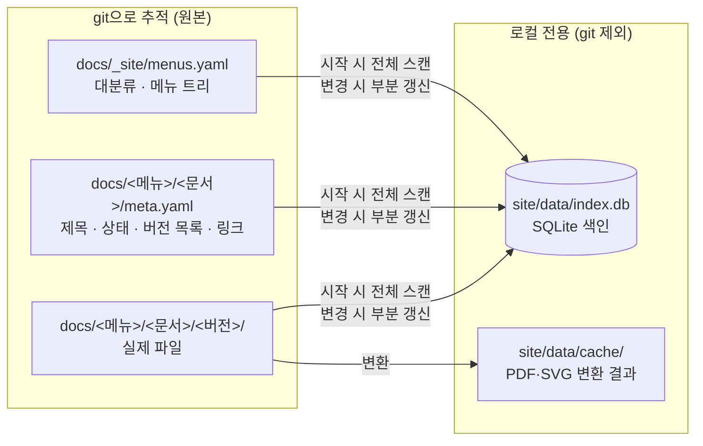
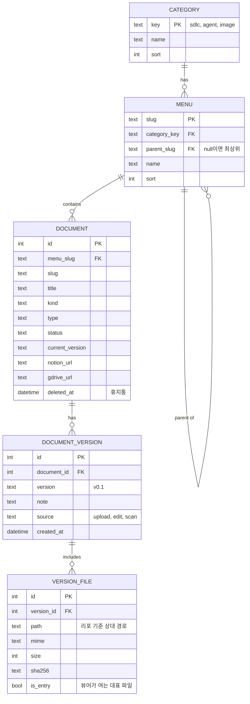
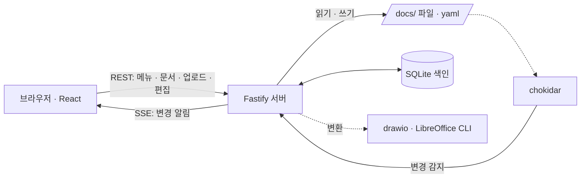

# 업무 문서 사이트 요구사항

이 리포 아래에 쌓이는 설계 문서와 파일을 **메뉴 + 뷰어** 형태의 웹사이트로 관리한다. 사이트의 목표는 세 가지다.

1. **문서 관리**: 제목, 메뉴 위치, 버전을 한곳에서 관리한다.
2. **파일 관리**: HTML, 이미지, PDF, PPT, Word, Excel, Markdown을 올리고 정리한다.
3. **쉬운 수정**: 올린 문서를 바로 보고, Markdown은 사이트에서 고쳐 새 버전으로 남긴다.

> 상태: **v0.6** (2026-10-13). 1~5·7~9단계 완료. 6단계(외부 연동)는 D-7에 따라 보류. 결정된 항목은 6절에 있다. 8단계(Markdown 편집기 MarkFlow 이식)는 5.2절, 9단계(좌측 폴더 트리·하위 문서)는 5.3절.

---

## 1. 화면 구성

```
┌──────────────────────────────────────────────────────────────────┐
│  로고   [ SDLC ]  [ Agent ]  [ Image ]                 검색  업로드 │  ← 상단: 대분류 메뉴
├───────────────────┬──────────────────────────────────────────────┤
│ ▾ 스프린트 Git-flow │  Git-flow 스프린트 개발 프로세스  draft ▾  draft │  ← 제목 · 버전 선택 · 상태
│    process        │ ──────────────────────────────────────────── │
│ ▾ 코드 리뷰 자동화   │                                              │
│    review-gate    │            콘텐츠 뷰어 영역                      │
│    review-modes   │   (HTML · 이미지 · PDF · PPT · Word · Excel)     │
│ ▸ 빌드·배포         │                                              │
│                   │   Markdown이면 좌: 편집기 │ 우: 미리보기         │
│ + 메뉴 추가         │                                              │
└───────────────────┴──────────────────────────────────────────────┘
     좌측: 메뉴 목록                  우측: 콘텐츠 뷰어
```

- **상단**: 대분류 메뉴 `SDLC`, `Agent`, `Image`로 시작한다. 나중에 사이트에서 추가하거나 순서를 바꿀 수 있다.
  - **SDLC**: 요구사항부터 운영까지의 설계 문서. 기존 문서는 모두 여기에 둔다.
  - **Agent**: 리뷰 에이전트, 스킬, 프롬프트 같은 에이전트 관련 문서.
  - **Image**: 다이어그램, 스크린샷 같은 이미지 자료.
- **좌측**: 선택한 대분류 아래의 메뉴 트리와, 메뉴마다 속한 문서 제목.
- **우측**: 선택한 문서의 뷰어. 상단 바에 제목, 버전 선택, 상태, 다운로드, (Markdown이면) 편집, 외부 링크(Notion·Drive)를 둔다.
- 좁은 화면에서는 좌측 목록을 접는 서랍으로 바꾼다. 콘텐츠 영역 안에는 가로 스크롤이 생기지 않게 한다(기존 문서 규칙과 같음).
- 문서마다 고유 URL이 있어 바로 열 수 있다. 예: `/sdlc/sprint-gitflow/process?v=v0.0`

## 2. 기능 요구사항

### 2.1 뷰어

| 형식 | 표시 방법 | 비고 |
|---|---|---|
| HTML | sandbox iframe | 기존 `docs/` 문서가 그대로 열려야 한다. 상대 링크와 같은 폴더의 리소스 포함 |
| 이미지 (SVG · PNG · JPG · GIF · WebP) | 확대/축소, 이동, 원본 크기, 화면 맞춤 | SVG는 스크립트를 제거하고 표시 |
| PDF | 브라우저 내장 PDF 뷰어(페이지 넘김, 확대, 썸네일, 검색, 인쇄) | 3단계에서 pdf.js 대신 내장 뷰어로 변경 |
| PPT (PPTX) | 서버에서 LibreOffice로 PDF 변환 → PDF 뷰어 | 변환 결과는 캐시. LibreOffice 설치 필요 |
| Word (DOCX) | 브라우저 렌더(`docx-preview`). 깨지면 PPTX와 같은 PDF 변환 방식 사용 | |
| Excel (XLSX · CSV) | 시트 탭 + 표 | 읽기 전용. 열이 많아도 가로 스크롤 대신 칸 안에서 줄바꿈. 앞 2,000행만 표시 |
| Markdown | **좌: 편집기 / 우: 렌더링 미리보기** 분할 화면 | GFM 표, Mermaid 다이어그램, 코드 하이라이트 |
| 코드 · 텍스트 (yaml, json, sh, ts …) | 코드 하이라이트 | 읽기 전용 |
| draw.io (`.drawio`) | 서버에서 SVG로 변환 → 이미지 뷰어 | 원본은 다운로드해서 draw.io로 편집 |

### 2.2 업로드

- 업로드할 때 **대분류 → 메뉴**를 고르고 제목을 입력한다.
- 업로드가 끝나면 좌측 목록에 제목이 **바로 나타나고**, 우측에서 즉시 열린다.
- **버전은 문서 단위로 쌓인다.** 같은 문서에 파일을 다시 올리면 덮어쓰지 않고 그 문서의 새 버전이 된다. 다른 문서의 버전에는 영향이 없다.
- 버전 번호는 자동으로 제안하고 업로드할 때 바꿀 수 있다. 새 문서는 `v0.0`(화면에는 draft), 수정·재업로드마다 `v0.1`, `v0.2` …, 정식 확정은 `v1.0`(D-6, D-16). 변경 메모를 함께 적는다.
- 파일 내용이 직전 버전과 같으면(sha256 비교) 새 버전을 만들지 않고 알린다.
- 여러 파일을 한 번에, 끌어다 놓기로 올릴 수 있다.
- HTML 문서와 그 문서가 쓰는 이미지처럼 여러 파일로 된 문서는 폴더째(또는 zip으로) 올린다. 이때 뷰어가 열 대표 파일을 지정한다.

### 2.3 문서 · 파일 관리

- 메뉴: 추가, 이름 변경, 순서 변경, 하위 메뉴 만들기.
- 문서: 제목·상태(`draft`·`review`·`approved`) 변경, 다른 메뉴로 이동, 삭제(휴지통 후 영구 삭제).
- 버전: 버전 목록, 이전 버전 보기, 변경 메모. 텍스트 형식(Markdown, HTML, 코드)은 두 버전 비교(diff).
- 검색: 제목과 본문(최신 버전의 Markdown·HTML·텍스트)에서 찾고, 대분류·파일 형식으로 좁힌다.

### 2.4 수정

- **Markdown만** 사이트 안에서 편집한다. 저장하면 새 버전이 된다.
- 다른 형식은 보기와 다운로드만 한다. 고친 파일은 다시 업로드해서 새 버전으로 올린다.

### 2.5 실시간 반영

- 업로드나 편집 결과가 새로고침 없이 목록과 뷰어에 반영된다.
- `docs/` 폴더를 사이트 밖에서 직접 고친 경우(에디터, Claude Code, git pull 등)에도 반영된다. 파일 감시 → 색인 갱신 → 브라우저로 알림 순서로 동작한다.

### 2.6 외부 연동

- Notion·Google Drive 등록 링크를 문서 정보로 보여준다.
- 등록 자체는 지금처럼 Claude Code로 한다. 사이트에서 등록하는 기능은 6단계(선택)에서 다시 정한다.

## 3. 데이터

### 3.1 원본은 파일, DB는 색인



- **원본은 git에 있는 파일**이다. 메뉴 구조는 `docs/_site/menus.yaml`, 문서 정보는 문서마다 있는 `meta.yaml`, 실제 파일은 버전 폴더에 둔다.
- **SQLite는 색인**이다. 사이트가 시작할 때 `docs/`를 스캔해 다시 만들 수 있으므로 git에 넣지 않는다. 다른 컴퓨터에서 리포를 받아도 같은 사이트가 열린다.
- 사이트에서 업로드하거나 정보를 바꾸면 **파일과 yaml을 먼저 쓰고**, 그 결과를 색인에 반영한다.

### 3.2 폴더 구조

```
docs/
  _site/menus.yaml                      # 대분류 · 메뉴 트리 · 순서
  sprint-gitflow/                       # 메뉴 slug
    process/                            # 문서 slug
      meta.yaml
      v0.0/process.html     # draft
      v0.1/process.html     # 첫 수정
  code-review-automation/
    review-gate/
      meta.yaml
      v0.0/review-gate.html
    review-modes/
      meta.yaml
      v0.0/review-modes.html
      v1.0/review-modes.html
```

```yaml
# docs/<메뉴>/<문서>/meta.yaml
title: Git-flow 스프린트 개발 프로세스
category: sdlc
menu: sprint-gitflow
kind: html              # html | image | pdf | pptx | docx | xlsx | markdown | code | drawio
type: process           # requirements | sequence | erd | architecture | process | build-deploy | decision
sdlc: develop
status: draft
current: v0.0
versions:
  - version: v0.0
    entry: process.html # 뷰어가 여는 대표 파일
    note: 2주 스프린트 기준으로 재작성
    source: upload      # upload | edit | scan | release
    created: 2026-10-06
notion_url:
gdrive_url:
```

- 메뉴 slug는 리포 전체에서 하나만 존재한다. 하위 메뉴와 대분류 소속은 `menus.yaml`에서 정하므로, 메뉴를 옮겨도 파일 경로는 바뀌지 않는다.
- 문서를 다른 메뉴로 옮기면 문서 폴더가 새 메뉴 폴더 아래로 이동한다.
- **하위 문서**(9단계, D-34)는 상위 문서 폴더 안에 둔다: `docs/<메뉴>/<상위 문서>/<하위 문서>/meta.yaml`. 문서 폴더 안에서 버전 폴더(`vN.N`)가 아니고 `meta.yaml`이 있는 폴더가 하위 문서다. 문서 slug는 메뉴 안에서(깊이와 상관없이) 하나뿐이라 주소·API는 계속 `대분류/메뉴/문서`다.
- 같은 자리(메뉴 바로 아래 또는 같은 상위 문서 아래) 안의 문서 순서는 `meta.yaml`의 `order`(0, 1, 2 …)다. 없으면 order가 있는 문서 뒤에 제목순으로 온다.

### 3.3 색인 스키마 (SQLite)



## 4. 기술 스택

| 영역 | 선택 | 이유 |
|---|---|---|
| 프론트엔드 | React + TypeScript + Vite | 요구사항 |
| 라우팅 · 서버 상태 | React Router, TanStack Query | 문서마다 고유 URL, 업로드 후 목록 자동 갱신 |
| UI | Tailwind CSS + Radix UI | 기존 문서의 색 토큰(`--bg`, `--accent` …)과 다크 모드를 그대로 옮길 수 있음 |
| 백엔드 | Node.js + Fastify + TypeScript | 파일 업로드, 정적 파일 제공, SSE를 한 서버에서 처리 |
| 색인 DB | SQLite (`better-sqlite3`) + Drizzle ORM | 로컬 파일 하나 |
| yaml | `yaml` 패키지 | meta.yaml, menus.yaml 읽기·쓰기 |
| 파일 감시 · 실시간 | chokidar + Server-Sent Events | 디스크 변경을 감지해 브라우저에 알림 |
| PDF | 브라우저 내장 PDF 뷰어 (iframe) | 페이지·확대·썸네일·검색을 브라우저가 제공해 직접 구현하지 않음. PPTX 변환 결과도 이 뷰어로 표시 |
| PPTX | LibreOffice headless (`soffice --convert-to pdf`) | 서버에서 변환하고 결과를 캐시 |
| DOCX | `docx-preview` | |
| XLSX · CSV | SheetJS | |
| Markdown | CodeMirror 6 (편집) + `react-markdown` · remark-gfm · Mermaid (미리보기) | |
| 코드 하이라이트 | Shiki | VS Code와 같은 문법 정의 |
| 이미지 확대 · 이동 | `react-zoom-pan-pinch` | |
| draw.io | 설치된 `drawio` CLI로 SVG 변환 (서버) | |



- 앱 코드는 리포의 `site/` 폴더에 둔다. `docs/`는 문서 저장소로 남는다.
- 실행: `npm run dev` 하나로 서버와 프론트엔드를 함께 띄운다. 로컬 전용이라 로그인은 없고, 서버는 `127.0.0.1`에만 연다.

## 5. 단계별 계획

각 단계는 **완료 기준을 만족하고 화면으로 확인한 뒤** 다음 단계로 넘어간다. 단계마다 시작 전에 아래 "먼저 확인할 것"을 묻는다.

| 단계 | 내용 | 완료 기준 | 먼저 확인할 것 |
|---|---|---|---|
| **0. 요구사항 확정** | 결정 항목 정리 | 이 문서 v0.2 | 완료 |
| **1. 뼈대와 읽기** ✅ | ① 기존 문서 3건을 문서 단위 구조로 이전 + `menus.yaml`·문서별 `meta.yaml` 생성 + CLAUDE.md 갱신<br>② `site/` 프로젝트 생성, 색인 스캔<br>③ 상단/좌측/우측 레이아웃, HTML·이미지·코드 뷰어 | 기존 문서 3건이 SDLC 메뉴에 나오고 열림. URL로 바로 열림. 색인 DB를 지우고 다시 시작해도 같은 화면 | 완료 (2026-10-06) |
| **2. 업로드와 버전** ✅ | 메뉴 지정 업로드, 문서 단위 새 버전, 버전 선택, 실시간 반영(SSE + 파일 감시) | 업로드 직후 목록·뷰어에 반영. 디스크에서 고친 파일도 반영 | 완료 (2026-10-06) |
| **3. 문서 뷰어** ✅ | PDF, DOCX, XLSX, PPTX, draw.io 뷰어 | 형식별 샘플 파일이 모두 열림 | 완료 (2026-10-06) |
| **4. Markdown 편집** ✅ | 분할 편집기, 저장하면 새 버전, 텍스트 diff | 편집 → 저장 → 새 버전 → 이전 버전과 비교 | 완료 (2026-10-06) |
| **5. 관리 기능** ✅ | 메뉴 편집, 문서 이동·삭제·휴지통, 상태 변경, 검색 | 관리 작업이 모두 화면에서 가능 | 완료 (2026-10-06) |
| **6. 외부 연동 (선택)** | Notion 등록, Google Drive 업로드, export(PDF·PNG) | 문서 한 건을 사이트에서 등록 | 보류 (D-7) |
| **7. 상단 메뉴 관리** ✅ | 대분류를 `categories.yaml` + `top_menu` 테이블로 분리, 헤더에서 추가·이름 변경·삭제·끌어서 순서 변경 | 아래 5.1의 완료 기준 | 완료 (2026-10-07) |
| **8. Markdown 편집기 개편** ✅ | MarkFlow 에디터 소스를 이식: 서식 툴바, 미리보기 엔진 교체, Cloudflare R2 이미지 업로드, `[[` 문서 링크 | 아래 5.2의 완료 기준 | 완료 (2026-10-12) |
| **9. 좌측 폴더 트리** ✅ | MarkFlow 사이드바 방식: 폴더 아이콘, 하위 문서, 끌어서 놓기, 오른쪽 클릭 메뉴, 폴더 추가·이름 변경·삭제 | 아래 5.3의 완료 기준 | 완료 (2026-10-13) |

### 5.1 7단계 계획: 상단 메뉴(대분류) 관리

**목표**: 상단의 SDLC · Agent · Image 같은 대분류를 좌측 메뉴와 분리된 데이터로 관리하고, 헤더에서 바로 추가·이름 변경·삭제·순서 변경을 한다.

**데이터 (D-17)**

```
docs/_site/
  categories.yaml   # 새로 분리: 상단 메뉴(대분류) 원본
  menus.yaml        # 좌측 메뉴 트리만. 대분류 key별 목록
```

```yaml
# categories.yaml
categories:
  - key: sdlc
    name: SDLC
  - key: agent
    name: Agent
```

```yaml
# menus.yaml (바뀐 구조: 대분류 이름은 빠지고 key별 트리만 남는다)
menus:
  sdlc:
    - slug: sprint-gitflow
      name: 스프린트 Git-flow 프로세스
  image:
    - slug: git
      name: Git관련이미지
```

- 색인 DB: `category` 테이블을 **`top_menu`**(key, name, sort)로 바꾸고 좌측 `menu` 테이블과 분리한다. `menu.category_key`가 `top_menu.key`를 가리킨다.
- 원본은 계속 파일이다(D-8). DB를 지워도 두 yaml에서 다시 만든다.
- 기존 `menus.yaml`은 한 번 변환해 두 파일로 나눈다(내용 변화 없음).

**규칙**

| 작업 | 조건 | 확인 창 |
|---|---|---|
| 추가 | 이름 필수, key는 영문 소문자·숫자·하이픈이고 중복 금지 | 일반 |
| 이름 변경 | key는 바꾸지 않는다(URL과 meta.yaml이 key를 쓰므로) | 일반 |
| 삭제 | **하위 메뉴가 없을 때만**. 마지막 하나는 지울 수 없다 | 위험 |
| 순서 변경 | 끌어다 놓기 또는 ⋯ 메뉴의 왼쪽·오른쪽 이동 | 없음(바로 되돌릴 수 있음) |

**헤더 UX (D-18)**

```
┌──────────────────────────────────────────────────────────────────┐
│ [로고]  SDLC ⋯ │ Agent │ Image │ ＋        [검색 🔍]      [⬆]  │
└──────────────────────────────────────────────────────────────────┘
          ▲ 마우스를 올리거나 선택된 탭에 ⋯ 표시 → 이름 변경 · 왼쪽/오른쪽으로 · 삭제
          ▲ 탭을 끌어다 놓으면 순서 변경(놓을 자리에 세로 표시선)
                                 ▲ ＋ → 이름·key 입력 팝오버 → 확인 창 → 추가 후 새 대분류로 이동
```

- 대분류 관리는 헤더로 옮기고, 좌측 관리 모드의 "대분류 관리"와 대화상자는 없앤다.
- 이름 변경은 탭 자리에서 바로 입력(Enter 저장, Esc 취소).
- 삭제할 수 없는 대분류(하위 메뉴 있음)는 ⋯ 메뉴의 삭제를 비활성화하고 이유를 보여준다.
- 지금 보고 있는 대분류를 지우면 첫 번째 대분류로 이동한다.

**작업 순서와 완료 기준**

1. `menus.yaml` → `categories.yaml` + 새 `menus.yaml` 변환, 스캔·스키마(`top_menu`) 변경 → 색인 결과가 변환 전과 같다(경고 0)
2. 관리 함수(`manage.ts`)를 두 파일 기준으로 변경 → API로 추가·이름·순서·삭제(하위 메뉴 있으면 거부) 확인
3. 헤더 UI: ＋ 추가 팝오버, ⋯ 메뉴, 인라인 이름 변경, 끌어서 순서 변경 → 브라우저에서 전 과정 확인
4. 좌측 "대분류 관리" 제거, CLAUDE.md·이 문서 갱신

### 5.2 8단계 계획: Markdown 편집기 개편 (MarkFlow 이식, 2026-10-12)

MarkFlow(`github.com/claude-code-expert/markflow`, 로컬 `~/project/markflow`)의 `packages/editor`(`@markflow/editor`) 소스를 우리 리포에 복사해 고쳐 쓴다(D-30). 패키지로 연결하지 않는다.

| 원본(`packages/editor/src`) | 사이트(`site/web/src/viewers/`) | 바꾼 점 |
|---|---|---|
| `MarkdownEditor.tsx` | `markdown-editor/MarkdownEditor.tsx` | 값은 `MarkdownViewer`가 쥐고, 저장·메모·임시 보관은 툴바 오른쪽(`toolbarEnd`)과 그 아래(`notice`)에 붙인다. 이모지 대신 Lucide, 글자 한국어 |
| `toolbar/Toolbar.tsx` | `markdown-editor/Toolbar.tsx` | `IconButton` + 공통 툴팁(`data-tip`). 자체 밝게·어둡게 버튼 제거(사이트 다크 모드를 따름). 이전 버전은 보기 방식 버튼만 |
| `editor/EditorPane.tsx` | `markdown-editor/EditorPane.tsx` | 바탕은 사이트 토큰. `[[` 후보는 사이트 문서 목록, 고르면 `[제목](/대분류/메뉴/문서)`(D-33) |
| `utils/parseMarkdown.ts`, `preview/PreviewPane.tsx`, `styles/preview-content.css` | `markdown-editor/parseMarkdown.ts`, `MarkdownPreview.tsx`, `markdown-editor/preview.css` | 상대 경로를 버전 폴더 기준으로 풀기, `#` 링크는 같은 탭, Mermaid 그리기 추가, 색은 사이트 토큰, 코드 블록은 줄바꿈(가로 스크롤 금지) |
| `toolbar/SettingsModal.tsx` + `ImageUploadGuide.tsx` | `markdown-editor/UploadSettingsDialog.tsx` | 공통 `Modal` 하나로 합침 |
| `utils/markdownActions.ts`, `cloudflareUploader.ts`, `imageValidation.ts`, `wordCount.ts` | 같은 이름 | 자리표시 글자·오류 문구 한국어. 여러 줄 접두어(목록·인용)가 어긋나던 원본 버그 수정 |
| `apps/worker` | `site/cloudflare/r2-uploader/` | 이름·허용 주소만 바꿈. 배포 방법은 그 README |

- **미리보기 엔진 교체(D-31)**: react-markdown + Shiki → unified(remark-gfm·remark-breaks·remark-math, rehype-highlight·rehype-katex·rehype-raw·rehype-sanitize). 편집 미리보기, 이전 버전 보기, 프레젠테이션이 모두 이 엔진을 쓴다. 바뀌는 점: 줄바꿈 한 번이 `<br>`로 보인다, 수식($…$)이 그려진다, 문서 안 HTML은 허용 목록 밖 태그·속성이 지워진다.
- **이미지(D-32)**: 툴바 "이미지 올리기", 편집 창 끌어 놓기·붙여넣기 → Cloudflare Worker `POST /upload` → R2 공개 주소를 ``로 넣는다. Worker 주소는 브라우저 localStorage(`mf-cf-worker-url`)에 두고, 설정 창에서 테스트 업로드가 성공해야 저장된다.
- **새 문서(D-11 보완)**: 업로드 대화상자 "새 Markdown 문서"로 만들면 편집 창이 열리고 커서가 문서 끝에 있다(라우터 state `edit`).
- 그대로 두는 것: 저장하면 새 버전(D-10), 확인 창, 임시 보관과 떠날 때 경고, 이전 버전 읽기 전용.

**완료 기준 (2026-10-12 모두 충족, 자동 테스트는 `TESTING.md` TC-MD-01~14, TC-UI-09·22~26)**

1. 툴바 서식 24종이 고른 글자에 적용되고 미리보기에 보인다.
2. 보기 방식(편집만·나란히·미리보기만) 전환, 편집 위치의 제목으로 미리보기 이동, 상태 표시줄(줄·글자·커서), Markdown 복사.
3. `[[`로 사이트 문서를 골라 링크를 넣는다.
4. 이미지 업로드: 설정 → 테스트 업로드 → 올리기 → 주소가 들어간 채로 새 버전 저장.
5. 이전 버전은 서식 툴바 없이 읽기 전용, 새 문서는 편집 화면으로 열린다.

### 5.3 9단계 계획: 좌측 폴더 트리와 하위 문서 (2026-10-13)

MarkFlow 사이드바(`apps/web/components/category-tree.tsx`, `sidebar.tsx`, `folder-context-menu.tsx`)와 같은 폴더 트리로 바꾼다. 폴더는 지금의 메뉴(`menus.yaml`)이고, 폴더 안에 하위 폴더와 문서, 문서 안에 하위 문서를 둔다. MarkFlow에는 하위 문서가 없고(문서 관계는 링크 그래프) 폴더 끌어 놓기는 같은 단계 순서만 되므로, 이 두 가지는 사이트에서 더한다.

- **화면** (`components/Sidebar.tsx`, `components/sidebar/ContextMenu.tsx`): 폴더는 펼침 화살표 + 폴더 아이콘(열림·닫힘) + 이름 + 문서 수, 문서는 문서 아이콘 + 제목 + 버전 배지, 하위 문서가 있으면 화살표. 접힌 항목은 localStorage(`workflow:sidebar-collapsed`)에 기억하고, 지금 연 문서의 상위는 늘 펼친다. 이전의 "메뉴 관리" 모드(↑↓·연필 버튼)는 없앴다.
- **메뉴(오른쪽 클릭 또는 ⋯)**: 폴더는 새 문서·하위 폴더 추가·이름 바꾸기·위로·아래로·다른 위치로 옮기기·폴더 삭제. 문서는 하위 문서 추가·이름 바꾸기·위로·아래로·상위 문서 밖으로 꺼내기·휴지통으로.
- **폴더 추가·이름 변경**: 사이드바 머리의 폴더 추가 버튼이나 폴더 메뉴에서, 그 자리 입력칸에 이름을 넣고 Enter(확인 창). slug는 자동이다(D-35).
- **끌어서 놓기**: 줄의 위쪽 28%는 앞, 아래쪽 28%는 뒤, 가운데는 안. 폴더 → 다른 폴더의 앞·뒤·안, 문서 → 폴더 안, 다른 문서의 앞·뒤·안(하위 문서). 자기 자신·자기 하위로는 놓을 수 없다. 같은 자리 안 순서 바꾸기는 확인 없이, 다른 자리로 옮기기는 확인 창(주황)을 거친다. 바깥 파일을 폴더에 놓으면 이전처럼 업로드 창이 열린다.
- **폴더 삭제(D-13 개정)**: 폴더 이름을 입력해야 삭제 버튼이 켜진다. 안의 문서(하위 문서 포함)와 하위 폴더의 문서는 휴지통으로 옮기고 폴더는 `menus.yaml`에서 뺀다. 복원할 때는 원래 폴더가 없으므로 복원할 폴더를 고른다.
- **하위 문서 만들기**: 문서 메뉴의 "하위 문서 추가" → 업로드 창(위치 고정). 업로드 창의 새 문서에도 "위치"(메뉴 바로 아래 / 어느 문서 아래) 선택이 있다. MCP `upload_document`는 `parent`를 받는다.
- **API**: `POST /api/upload`에 `parent`, `POST /api/docs/:menu/:doc/move`가 `{ menu, parent?, index? }`를 받는다(다른 메뉴·다른 문서 아래·같은 자리 순서). 하위 문서째 다른 메뉴로 옮길 때 옮기는 문서 slug가 겹치면 `-2`를 붙이고, 하위 문서 slug가 겹치면 409. `DELETE /api/menus/:slug`는 `{ trashed }`(휴지통으로 간 문서 수)를 돌려준다. `/api/tree`의 문서에 `parent`가 붙고, 문서는 order → 제목 순이다.
- **휴지통**: 문서를 휴지통으로 보내면 하위 문서도 함께 간다. 복원은 메뉴 바로 아래로 한다(하위 문서였어도).
- 그대로 두는 것: 메뉴 폴더 위치(`docs/<메뉴 slug>/`)와 메뉴를 다른 대분류로 옮기는 대화상자, 확인 창 규칙.

**완료 기준 (2026-10-13 모두 충족, 자동 테스트는 `TESTING.md` TC-TREE-01~05, TC-MNG-04, TC-UI-27~30)**

1. 폴더 아이콘이 있는 트리에 폴더 → 하위 폴더·문서 → 하위 문서가 보이고 접고 펼친다.
2. 폴더 추가(한글 이름도)·이름 변경·하위 폴더 추가를 그 자리에서 한다.
3. 끌어서 놓기로 문서를 하위 문서로 넣고, 같은 자리 순서를 바꾸고, 폴더를 다른 폴더 안·밖으로 옮긴다.
4. 문서 메뉴에서 하위 문서를 만들면 상위 문서 폴더 안에 생긴다.
5. 폴더 삭제는 이름을 입력해야 되고, 안의 문서는 휴지통에서 복원할 수 있다.

## 6. 결정 사항

| ID | 질문 | 결정 | 결정일 |
|---|---|---|---|
| D-1 | 파일 저장 위치와 버전 단위 | **문서 단위 버전**: `docs/<메뉴>/<문서>/<버전>/`. 기존 업무 단위 구조(`docs/<업무>/<버전>/`)에서 이전한다 | 2026-10-06 |
| D-2 | 사용 범위 | **로컬 전용**: localhost, 로그인 없음. 예외: Markdown 편집기의 이미지는 Cloudflare R2에 올린다(D-32) | 2026-10-06 |
| D-3 | 사이트 안 편집 범위 | **Markdown만**. 나머지는 보기와 재업로드. → 2.0에서 HTML·DOCX·PPTX 텍스트 편집 추가로 개정(`REQUIREMENT-2.0.md`) | 2026-10-06 |
| D-4 | PPTX 표시 방법 | **LibreOffice로 PDF 변환** 후 PDF 뷰어 | 2026-10-06 |
| D-5 | 대분류 | **SDLC · Agent · Image**로 시작, 사이트에서 추가 가능 | 2026-10-06 |
| D-8 | 메타데이터 원본 | **문서별 meta.yaml + menus.yaml이 원본**, SQLite는 다시 만들 수 있는 색인(git 제외) | 2026-10-06 |
| D-6 | 버전 번호 규칙 | **자동 제안**(새 문서 `v0.0` → `v0.1` → `v0.2`, D-16) + 업로드할 때 수정 가능 | 2026-10-06 |
| D-9 | 업로드 진입점 | **두 가지 모두**: 상단 "업로드" 버튼(대분류·메뉴 선택) + 좌측 메뉴별 `+` 버튼(메뉴 고정). 메뉴에 파일을 끌어다 놓아도 열린다 | 2026-10-06 |
| D-10 | Markdown 저장 방식 | **"저장" 버튼을 누를 때만 새 버전**(source: edit). 저장 전 작성 내용은 브라우저에 임시 보관 | 2026-10-06 |
| D-11 | 사이트에서 새 Markdown 문서 만들기 | **지원**: 업로드 대화상자의 "새 Markdown 문서" 탭 | 2026-10-06 |
| D-12 | 문서 삭제 | **휴지통**: `docs/_trash/`로 옮기고 사이트에서 복원·영구 삭제 | 2026-10-06 |
| D-13 | 메뉴 편집 범위 | **전부**: 대분류·메뉴 이름 변경, 순서 변경, 하위 메뉴, 대분류 간 이동, 문서 메뉴 이동. 대분류 삭제는 비어 있을 때만. → 2026-10-13 개정: 메뉴(폴더) 삭제는 폴더 이름을 입력하면 안의 문서를 휴지통으로 옮기고 지운다(5.3) | 2026-10-06 |
| D-14 | 검색 범위 | **제목 + 본문**(최신 버전의 Markdown·HTML·텍스트). SQLite FTS5 trigram 색인 위에서 부분 일치 | 2026-10-06 |
| D-16 | 최초 버전 번호와 표시 | **최초 작성·업로드 = `v0.0`, 화면에는 draft**. 수정마다 `v0.1`, `v0.2` …, 정식 확정 `v1.0`. 사이드바·검색 배지는 draft 문서는 draft, 그 밖에는 현재 버전을 보여준다. 기존 문서 3건의 최초본 v0.1을 v0.0으로 이름 변경 | 2026-10-06 |
| D-15 | 정식(v1.0 이상) 문서에 새 버전이 생길 때 상태 | **approved 유지**: 업로드·Markdown 저장은 버전만 올리고(v1.0 → v1.1) 상태는 바꾸지 않는다. 다음 정식 확정은 상태 배지로 v2.0 | 2026-10-06 |
| D-17 | 상단 메뉴(대분류) 저장 | **별도 파일 + 별도 테이블**: `docs/_site/categories.yaml`(원본) → 색인 `top_menu`. 좌측 메뉴는 `menus.yaml`에 대분류 key별 트리로 남긴다 | 2026-10-07 |
| D-18 | 헤더 UX | **헤더에서 바로 편집**(＋ 추가, ⋯ 이름 변경·삭제) + **끌어서 순서 변경**. 대분류 아이콘과 넘치는 탭 처리는 이번에 하지 않는다 | 2026-10-07 |
| D-7 | Notion·Drive 연동을 사이트에서 할지 | **보류**: Notion 통합 토큰·Google OAuth 설정은 나중에 진행. 그때까지 등록은 Claude Code(MCP)로 하고 사이트는 링크만 표시 | 2026-10-06 |
| D-30 | Markdown 편집기를 가져오는 방식 | **MarkFlow `packages/editor` 소스를 리포에 복사해 고쳐 쓴다**(`site/web/src/viewers/markdown-editor/`). 원본 리포에는 라이선스 표시가 없다(2026-10-12 확인) | 2026-10-12 |
| D-31 | Markdown 미리보기 엔진 | **MarkFlow 엔진(unified + remark/rehype)으로 교체**. 사이트 쪽에서 상대 경로 풀기와 Mermaid를 더한다 | 2026-10-12 |
| D-32 | 편집기 이미지 저장 위치 | **Cloudflare R2**(MarkFlow Worker, `site/cloudflare/r2-uploader`). 문서 버전 폴더에는 이미지 주소만 남는다 | 2026-10-12 |
| D-34 | 하위 문서 저장 방식 | **폴더도 중첩**: `docs/<메뉴>/<상위 문서>/<하위 문서>/`. 문서 slug는 메뉴 안에서 하나뿐이라 주소는 `대분류/메뉴/문서` 그대로. 문서 순서는 `meta.yaml` `order` | 2026-10-13 |
| D-35 | 폴더(메뉴) slug | **이름만 받고 자동**: 영문·숫자가 있으면 이름에서, 없으면 `folder-<난수 6자>`. 겹치면 `-2` … | 2026-10-13 |
| D-36 | 사이드바 끌어서 놓기 범위 | **전부**: 폴더 순서·다른 폴더 안으로, 문서 다른 폴더로·하위 문서로·같은 자리 순서. 같은 자리 순서는 확인 없이 | 2026-10-13 |
| D-33 | `[[` 문서 링크 | **넣는다**: 사이트 문서 목록에서 골라 일반 Markdown 링크 `[제목](/대분류/메뉴/문서)`로 넣는다(다른 Markdown 도구에서도 링크로 보이도록) | 2026-10-12 |

## 7. 범위 밖 (이번 버전)

- 로그인, 권한, 팀 공유 서버
- 여러 사람이 같은 문서를 동시에 편집하는 기능
- Markdown 외 형식의 사이트 안 편집
- 클라우드 배포
