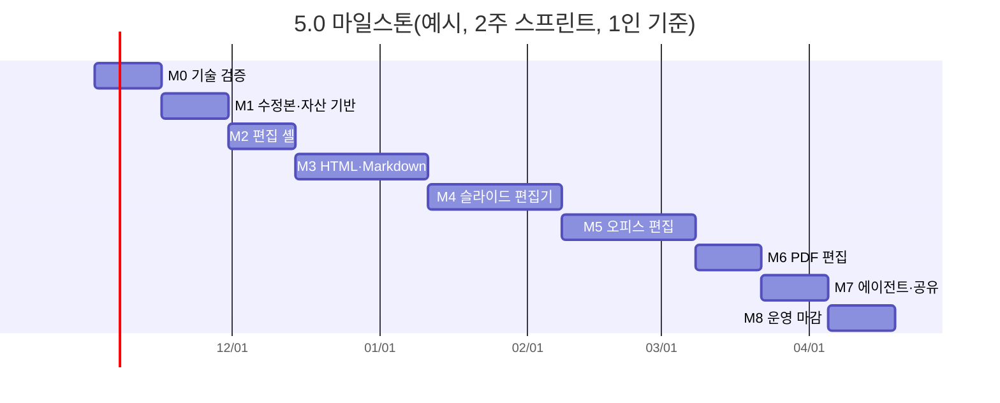

# 5.0 요구사항(계획): 문서 편집기 — 글자를 넘어 표·이미지·배치까지

지금은 글자만 고칠 수 있다(2.0 텍스트 편집: 태그 안 글자 교체, Markdown 편집기). 5.0에서는 HTML·DOCX·PPTX·XLSX·PDF와 에이전트가 만든 슬라이드에서 **표를 만들고 고치고, 열 너비를 바꾸고, 이미지를 올리고 바꾸는** 편집을 한다. 고친 결과는 D1(SQLite)에 목록·이력을 두고, 파일 정본과 수정본마다의 이력은 R2에 둔다.

> 상태: **v0.2** (2026-10-29). M0 기술 검증·M1 수정본·자산 기반 완료(7절 끝 "진행 결과"). D-47 확정(2026-10-29, 사용자: **C. OOXML 직접 구현**), 나머지 결정은 제안안으로 진행.
>
> 해석 하나: 요구의 "d2에 파일 정본"은 **R2**로 읽었다. 정본 파일은 지금도 R2에 sha256 이름으로 있고, 목록·버전은 D1(SQLite)에 있다. 다르면 9절 D-53에서 바로잡는다.

---

## 1. 요구 정리

| # | 요구 | 이 계획에서 |
|---|---|---|
| R1 | 형식: HTML, DOCX, PPTX, XLSX, PDF (+ 에이전트 슬라이드) | 형식마다 편집 방식이 다르다(4절) |
| R2 | 1차 범위: 표 생성·수정·열 너비, 이미지 업로드·교체·크기, 그 밖의 추가·편집 | 형식별 기능표(6절)로 확정 |
| R3 | 완성 문서는 SQLite(D1)에서 관리 | 기존 `document`·`document_version`에 수정본·자산 표를 더한다(5절) |
| R4 | 파일 정본과 버전별 이력은 R2 | 수정본마다 파일 목록(매니페스트)을 R2에 두고 D1이 가리킨다(5절) |
| R5 | 기능 개발 위주 계획과 마일스톤 | 7절(2주 스프린트 단위) |

## 2. 슬라이드 편집기 명세 분석

`docs/slide-editor-spec.html`은 에이전트가 만든 16:9 덱(제한된 HTML)을 사람이 클릭해 고치는 편집기 명세다. 범위는 슬라이드 하나지만, 그 안의 결정 상당수는 다른 형식에도 쓸 수 있다.

### 그대로 가져올 것

| 명세 | 다른 형식에도 쓰는 이유 |
|---|---|
| 요소마다 고정 id(`data-eid`)를 붙이고, 사람과 에이전트가 같은 **편집 연산**(`setText`, `setStyle`, `insert`, `tableCols` …)으로 고친다 | 연산은 대상 id로 적용되므로, 다른 사람이 먼저 저장해도 다시 적용해 볼 수 있다. HTML 문서 편집(4.1)에 같은 모양을 쓴다 |
| 연산이 역연산을 돌려주고 되돌리기는 역연산을 새로 저장한다. 서버에는 "되돌리기"가 없다 | 모든 편집기 공통 되돌리기·이력의 바탕 |
| `baseRev` 충돌 처리: 다르면 최신본에 연산을 다시 적용, 대상이 사라졌으면 409 | 지금 버전 저장의 409 규칙을 수정본 단위로 넓힌 것 |
| 이미지는 `asset:<sha256>`만 저장하고 그릴 때 서명 주소로 바꾼다 | 서명 토큰이 12~24시간이라 주소를 문서에 넣으면 깨진다. 모든 형식의 이미지 삽입에 쓴다 |
| 표 열 너비는 비율(합 100%)로만, 열 경계 손잡이를 끌면 이웃 두 열만 주고받는다 | HTML 표 편집에 그대로 |
| 렌더러는 허용 목록 노드만 그린다. 서버가 저장 전에 같은 검증기를 다시 돌린다 | 보안 원칙 |
| 글자 편집은 Tiptap(ProseMirror). 한글 조합 입력이 안정적이다 | 표 칸·HTML 블록 글자 편집에 공통 |
| 선택·이동·크기는 `react-moveable`, 순서는 `@dnd-kit`, 상태는 `zustand`+`immer` 패치 | 편집 셸(공통 기반)로 묶는다 |

### 명세와 요구가 어긋나는 곳

| 어긋남 | 조정 |
|---|---|
| 명세는 슬라이드 HTML을 **D1 행**(`slides.html`, `slide_revisions.html`)에 저장한다. 요구는 **정본을 R2**에 둔다 | 슬라이드 HTML도 R2 blob(sha256)로 두고, D1에는 수정본 번호와 blob 주소만 둔다(5.2). 슬라이드 한 장 단위로 저장하므로 바뀐 장만 올라간다 |
| 명세의 이력은 슬라이드 단위 `rev`뿐이고, 사이트의 버전(v0.0 → v0.1 → v1.0)과 연결이 없다 | **수정본**(자동 저장, 세밀)과 **버전**(이름 붙은 확정본, 기존)을 두 층으로 나눈다(5.1) |
| 명세 범위는 슬라이드뿐. DOCX·PPTX·XLSX·PDF는 다루지 않는다 | 형식별 방식을 따로 정한다(4절) |
| 명세는 덱을 새 객체(`decks`)로 둔다 | 덱도 하나의 문서(`kind: deck`)로 둬서 메뉴·트리·검색·휴지통·권한을 그대로 쓴다 |

## 3. 지금 있는 것 (출발점)

| 기능 | 위치 | 5.0에서 |
|---|---|---|
| 태그 안 글자 교체(HTML·DOCX·PPTX·XLSX·SVG) | `packages/core/src/textedit/` | 원본 위치 기반 교체 방식을 "구조 연산"으로 넓힌다(4.1, 4.4-C) |
| Markdown 편집기(CodeMirror, 이미지 업로드) | `site/web/src/viewers/markdown-editor/` | 표 편집 도구를 더한다 |
| 버전 저장(R2 내용 주소, D1 버전·파일 행, 409) | `apps/worker/src/write.ts` | 수정본 층을 더한다 |
| 편집기 이미지 업로드 `/api/w/:ws/images` | `apps/worker/src/app.ts` | 자산 표(`asset`)로 넓혀 모든 편집기가 쓴다 |
| 실시간(워크스페이스 Durable Object) | `apps/worker/src/live.ts` | 문서별 접속자·저장 알림을 더한다 |
| PDF 변환 컨테이너(LibreOffice) | `apps/converter` | DOCX·PPTX 내보내기·미리보기에 계속 쓴다 |
| 원격 MCP 도구 11개 | `packages/mcp-tools` | 구조 연산 도구를 더한다(7절 M7) |

## 4. 형식별 편집 방식

형식마다 "원본을 지키는 정도"와 "만들 기능의 양"이 다르다. 하나로 통일하지 않는다.

| 형식 | 방식 | 이유 |
|---|---|---|
| HTML(디자인된 단일 파일 문서) | **원본 패치 편집**: 화면에서 블록·표·이미지를 고르고 구조 연산으로 원본 HTML의 해당 구간만 바꾼다 | 이 리포의 HTML 문서는 토큰·목차·카드 같은 디자인이 있다. 범용 WYSIWYG로 열면 디자인이 깨진다 |
| Markdown | 기존 편집기 + 표 도구 | 원본이 텍스트라 지금 방식이 맞다 |
| 슬라이드(에이전트 덱) | **슬라이드 편집기**(명세 그대로, 정규 HTML 형식) | 에이전트가 쓰기 쉽고 사람이 diff로 읽는다 |
| DOCX·PPTX·XLSX | **결정 필요(D-47)**. 추천: 오피스 편집 서버(ONLYOFFICE Docs) | 표·이미지·서식·수식까지 원본 그대로 고쳐야 한다. 직접 만들면 형식마다 수개월이다(4.4) |
| PDF | **주석·페이지 편집**: 글상자·이미지·도장·형광펜·양식 채우기, 페이지 회전·삭제·순서·합치기 | PDF는 배치가 고정된 출력물이라 본문 다시 흘리기(reflow)는 하지 않는다 |

### 4.1 HTML 원본 패치 편집

2.0 텍스트 편집은 parse5가 준 텍스트 노드의 원본 위치만 바꿨다. 같은 원리를 **요소 단위**로 넓힌다.

- 편집 사본(`edit-view`)에서 블록 요소(`section`, `table`, `figure`, `img`, `p`, `li` …)에 `data-eid`를 붙여 보여 준다. 원본 파일에는 eid를 쓰지 않는다. eid는 원본의 요소 위치(시작·끝 바이트)로 정해지는 번호라, 같은 버전에서는 늘 같다.
- 연산은 슬라이드와 같은 모양을 쓴다: `setText`(인라인), `insert`(블록·표·이미지), `remove`, `move`(같은 부모 안), `setAttr`(src·alt·href), `tableRow`·`tableCol`(행·열 넣기·빼기), `tableCols`(열 너비).
- 서버는 연산마다 대상 요소의 원본 구간을 다시 써서 새 파일을 만든다. **바뀌지 않은 바이트는 그대로**(2.0의 원칙). 새로 넣는 요소는 같은 문서에 이미 있는 같은 종류 요소의 `class`를 따른다(예: 새 표는 문서의 첫 표와 같은 class). 그래서 문서 디자인 체계를 깨지 않는다.
- 표 열 너비: `<colgroup><col style="width:N%">`를 넣거나 고친다. 이 리포 HTML 규칙(`table-layout: fixed`)과 맞는다.
- 이미지: 업로드(자산 표) → ``는 버전 폴더 상대 경로로 넣고 파일을 새 버전에 함께 담는다. HTML 문서는 이미지를 버전 폴더에 두는 지금 구조를 지킨다(문서 단독으로 열려야 한다).
- 하지 않는 것: 임의 CSS 편집, 레이아웃(그리드 칸 수 등) 바꾸기, 스크립트. 필요하면 "HTML 원본 보기"를 읽기 전용으로 둔다.

### 4.2 Markdown

- 툴바에 "표 넣기"(행·열 수 고르기), 표 안에서 행·열 넣기·빼기, 열 정렬(`:---:`)을 더한다. CodeMirror에서 표 블록을 찾아 GFM 표 문법으로 다시 써 준다.
- 이미지는 지금처럼 업로드하고, 크기는 `{width=…}`처럼 비표준 문법을 쓰지 않고 HTML ``를 허용 목록에 둔다(미리보기 sanitize 허용 확인).

### 4.3 슬라이드 편집기

명세 `docs/slide-editor-spec.html`의 01~16절을 그대로 따른다. 바꾸는 곳은 2절 "어긋나는 곳"의 저장 위치(R2 정본)와 문서 모델(덱 = `kind: deck` 문서)뿐이다.

### 4.4 DOCX·PPTX·XLSX — 세 가지 길 (D-47)

| | A. 오피스 편집 서버 | B. 정규 모델로 바꿔 편집 | C. OOXML 구조 편집 직접 구현 |
|---|---|---|---|
| 무엇 | ONLYOFFICE Docs(커뮤니티판, AGPL)를 띄우고 화면에 편집기 iframe을 연다. 저장하면 서버가 파일을 돌려준다 | 파일을 편집기 모델로 바꿔 편집하고 다시 파일로 내보낸다(Tiptap+DOCX 변환, Univer 편집기) | 2.0 어댑터를 넓혀 표 행·열, 열 너비, 이미지 교체 같은 연산을 XML에 직접 적용 |
| 표·이미지·서식 | Word·Excel·PowerPoint 수준(수식·차트·병합 셀 포함) | 편집기가 아는 만큼. 가져오기에서 서식이 빠질 수 있다 | 만든 연산만 |
| 원본 충실도 | 높음(그 서버가 원본을 그대로 다룬다) | 낮음~중간(왕복하면 달라진다) | 높음(바뀐 부분만 다시 쓴다) |
| 만들 양 | 연결(저장 콜백·권한·버전 연결)만. 2~3스프린트 | 편집기 연결 + 변환 품질 보정. DOCX·XLSX 변환은 유료(Tiptap Pro, Univer Pro) | 형식×기능마다 구현 + 편집 화면. 형식당 수 스프린트 |
| 운영 | 상주 서버가 필요하다. Cloudflare Containers standard-3(2 vCPU·8 GiB) 1대부터. 콜드 스타트·세션 유지 검증 필요 | Workers·브라우저만 | Workers·브라우저만 |
| 비용·라이선스 | 컨테이너 사용료. AGPL(수정해 배포하면 공개 의무, 그대로 쓰면 해당 적음). 9.4부터 동시 접속 제한이 없어졌다는 보도(공식 확인 필요) | 유료 라이선스 | 없음 |
| 판단 | **추천**. 1차 범위(표·이미지·너비)를 바로 충족 | 원본 충실도 요구와 맞지 않는다 | 서버를 못 쓰게 될 때의 대안. 표 행·열·열 너비·이미지 교체만 |

추천 근거: 요구가 "텍스트가 아니라 표·이미지·배치 편집"이고, 업로드되는 오피스 파일은 사람이 Word·PowerPoint·Excel로 만든 것이다. 그 서식을 지키면서 편집하는 기능을 직접 만들면 형식마다 수개월이 들고 결과도 그 서버보다 못하다. 대신 상주 서버 운영이 생기므로, **M0에서 Containers 위 구동(메모리·콜드 스타트·세션 유지·한글 글꼴)을 먼저 검증**하고 안 되면 C로 범위를 줄인다.

A로 갈 때의 연결 구조:

```
브라우저 ─(편집기 iframe, JWT 서명 설정)─▶ 오피스 편집 서버(Containers)
                                              │ 파일 받기: GET /api/w/:ws/office/:docId/file?token   (R2 정본, 서명 토큰)
                                              │ 저장 콜백: POST /api/w/:ws/office/:docId/callback   (상태 2·6일 때 새 파일)
앱 Worker ◀───────────────────────────────────┘ → 새 파일을 R2에 올리고 수정본(5.1) 하나 추가 → 실시간 알림
```

- 편집기 설정은 앱 Worker가 JWT로 서명해 준다(편집 서버와 공유 비밀). viewer는 보기 모드로만 연다.
- 같은 문서를 여러 사람이 함께 열면 편집 서버가 동시 편집을 맡는다(문서 키 = 문서 id + 기준 수정본).
- 저장 콜백 하나가 수정본 하나가 된다. "버전 확정"은 지금처럼 사람이 한다(5.1).

### 4.5 PDF

- 보기: pdf.js(지금 브라우저 내장 뷰어 대신, 편집을 위해 라이브러리로 연다).
- 주석: 글상자, 이미지(서명·도장), 형광펜, 펜. pdf.js 편집 레이어를 쓰고, 저장은 `saveDocument()`로 받은 바이트를 서버에 올린다.
- 페이지: 회전·삭제·순서 바꾸기·다른 PDF 끼워 넣기는 pdf-lib로 한다(브라우저 또는 Worker).
- 양식 채우기: pdf-lib 폼 API. 한글은 Noto Sans KR 부분 글꼴을 넣는다(M0에서 크기·표시 검증).
- 하지 않는 것: 본문 글자 직접 수정·다시 흘리기. 필요하면 원본(DOCX 등)을 고치고 PDF를 다시 만든다.

## 5. 저장·버전·이력

### 5.1 두 층: 수정본과 버전

| | 수정본(revision) | 버전(version, 기존) |
|---|---|---|
| 언제 생기나 | 편집기 자동 저장(800ms 묶음), 오피스 편집 서버 저장 콜백, 에이전트 연산 | 사람이 "버전으로 저장"하거나 확정(v1.0)할 때, 업로드할 때 |
| 이름 | 문서 안 일련번호 `rev` | `v0.0`, `v0.1`, `v1.0` … |
| 보이는 곳 | 편집 화면 "이력" 패널(누가·언제·사람/에이전트·무엇) | 문서 상단 버전 선택, 비교 |
| 지우기 | 보존 정책(D-50)에 따라 오래된 것을 줄인다 | 지우지 않는다(버전 불변 원칙) |

- 편집을 시작하면 최신 버전을 기준으로 **작업본**이 열린다. 저장은 수정본을 쌓는다. "버전으로 저장"을 누르면 마지막 수정본을 다음 버전 번호(v0.x)로 올린다. 이때 R2 복사는 없다(같은 blob을 가리킨다).
- 수정본에서 되돌리기: 그 수정본의 파일 목록을 새 수정본으로 저장한다. 과거를 지우지 않는다.
- 다른 버전을 고치려면 그 버전에서 작업본을 새로 연다(기존 "이전 버전은 읽기 전용" 규칙 유지).

### 5.2 R2 정본과 D1

R2(정본, 내용 주소, 바뀌지 않음):

| 키 | 내용 |
|---|---|
| `ws/<id>/blobs/<sha256>` | 모든 파일 본문(기존). 슬라이드 HTML 한 장, 덱 색인 JSON, 편집된 DOCX, 주석 넣은 PDF 모두 여기 |
| `ws/<id>/blobs/<sha256>` (매니페스트) | 수정본 하나의 파일 목록 JSON: `{ entry, files: [{ path, sha256, size, mime }] }` |
| `ws/<id>/cache/…` | 변환·내보내기 결과(기존 PDF 캐시에 PPTX·PNG 미리보기 추가) |

D1(SQLite, 목록·관계·검색):

```sql
-- migrations/0004_revisions.sql (안)
CREATE TABLE document_revision (
  id INTEGER PRIMARY KEY AUTOINCREMENT,
  document_id INTEGER NOT NULL REFERENCES document(id),
  rev INTEGER NOT NULL,                    -- 문서 안 일련번호
  base_version TEXT NOT NULL,              -- 작업을 시작한 버전(v0.3 등)
  manifest_sha TEXT NOT NULL,              -- R2 매니페스트 blob
  author_id INTEGER REFERENCES app_user(id),
  source TEXT NOT NULL,                    -- human | agent | office | import | restore
  summary TEXT,                            -- 연산 요약(예: "표 1 열 추가, 이미지 2 교체")
  ops_sha TEXT,                            -- 적용한 연산 목록 blob(구조 편집일 때. 감사·재적용용)
  created_at TEXT NOT NULL,
  UNIQUE (document_id, rev)
);
CREATE TABLE document_head (               -- 작업본의 현재 수정본(빠른 조회·동시성 검사)
  document_id INTEGER PRIMARY KEY REFERENCES document(id),
  rev INTEGER NOT NULL, base_version TEXT NOT NULL, updated_at TEXT NOT NULL
);
CREATE TABLE asset (                       -- 편집기에서 올린 이미지(중복 제거·크기 정보)
  workspace_id INTEGER NOT NULL, sha256 TEXT NOT NULL, mime TEXT NOT NULL, size INTEGER NOT NULL,
  width INTEGER, height INTEGER, created_by INTEGER, created_at TEXT NOT NULL,
  PRIMARY KEY (workspace_id, sha256)
);
-- document_version에 revision_id(어느 수정본을 올렸는지)를 더한다
```

- 동시성: 저장 요청은 `baseRev`를 함께 보낸다. D1 batch에서 `UPDATE document_head … WHERE rev = baseRev`로 확인하고 `UNIQUE(document_id, rev)`가 경합을 막는다(4.0의 버전 저장과 같은 방식).
- 구조 편집(HTML·슬라이드)은 409를 받으면 화면이 최신 수정본에 남은 연산을 다시 적용한다. 오피스 편집 서버는 서버 쪽 동시 편집이라 409가 거의 없다.
- 검색 색인은 버전으로 올릴 때만 갱신한다(수정본마다 하면 D1 쓰기가 많다).
- 매일 정리 작업은 수정본·매니페스트가 가리키는 blob도 "쓰는 것"으로 센다(지금은 버전만 센다).

### 5.3 로컬 사이트(`site/`)

로컬 사이트는 SQLite 색인 + 리포 `docs/` 파일 구조라 수정본 층이 없다. 5.0 편집기는 **Cloudflare 앱에 먼저** 만든다. 로컬 사이트는 결과 보기만 하고, 편집된 문서는 내보내기 zip → 리포 `docs/`로 가져온다(D-51).

### 5.4 API (안)

| 요청 | 내용 |
|---|---|
| `POST /api/w/:ws/docs/:menu/:doc/work` | 버전에서 작업본 열기 `{ fromVersion }` → `{ rev, manifest }` |
| `POST …/revisions` | 구조 편집 저장 `{ baseRev, ops }` 또는 파일 교체 `{ baseRev, files }` → 새 rev(검증 진단 포함) |
| `GET …/revisions?cursor=` | 수정본 목록 |
| `GET …/revisions/:rev` | 그 수정본 매니페스트·파일 주소 |
| `POST …/revisions/:rev/restore` | 그 수정본을 새 수정본으로 |
| `POST …/publish` | 현재 작업본을 다음 버전으로 `{ note, version? }` |
| `POST /api/w/:ws/assets` | 이미지 올리기(있으면 건너뜀) → `{ asset: "asset:<sha>", width, height }` |
| `GET /api/w/:ws/assets/:sha/url` | 그릴 때 쓸 서명 주소 |
| `GET·POST /api/w/:ws/office/:docId/{config,file,callback}` | 오피스 편집 서버 연결(D-47 A일 때) |

## 6. 형식별 1차 기능

○ 1차, △ 일부, — 하지 않음, (오) 오피스 편집 서버가 제공(D-47 A일 때).

| 기능 | HTML | Markdown | 슬라이드 | DOCX | PPTX | XLSX | PDF |
|---|---|---|---|---|---|---|---|
| 표 넣기 | ○ | ○ | ○ | (오) | (오) | — | — |
| 행·열 넣기·빼기 | ○ | ○ | ○ | (오) | (오) | (오) | — |
| 열 너비 바꾸기 | ○ 끌기·숫자 | — (문법 없음) | ○ 끌기 | (오) | (오) | (오) | — |
| 칸 글자·서식 | ○ 인라인 마크 | ○ | ○ | (오) | (오) | (오) | — |
| 칸 병합 | — | — | — | (오) | (오) | (오) | — |
| 이미지 올리기·넣기 | ○ | ○(지금) | ○ | (오) | (오) | (오) | ○ 도장·서명 |
| 이미지 교체·크기·정렬 | ○ | △ 크기만 | ○ 자르기 포함 | (오) | (오) | (오) | ○ 위치·크기 |
| 블록 넣기·지우기·옮기기 | ○ | ○(편집기) | ○ | (오) | (오) | — | ○ 페이지 단위 |
| 글자 서식(굵게·색·링크) | ○ | ○ | ○ | (오) | (오) | (오) | ○ 글상자 |
| 수식·차트 | — | ○ 수식(KaTeX) | — | (오) | (오) | (오) | — |
| 되돌리기·다시 하기 | ○ | ○ | ○ | (오) | (오) | (오) | ○ |
| 자동 저장·수정본 이력 | ○ | ○ | ○ | ○ 저장 콜백 | ○ | ○ | ○ |
| 버전으로 저장·확정 | ○ | ○ | ○ | ○ | ○ | ○ | ○ |
| 동시 편집 | 슬라이드·블록 단위 잠금 없음, 409 재적용 | 409 | 409 재적용 | (오) 실시간 | (오) | (오) | 409 |
| 에이전트(MCP) 편집 | ○ 연산 | ○ 전체 저장(지금) | ○ 연산 | △ 글자(지금 2.0) | △ | △ | — |

D-47에서 C를 고르면 DOCX·PPTX는 "행·열 넣기·빼기, 열 너비, 이미지 교체"만 ○가 되고 나머지는 —가 된다.

## 7. 마일스톤

2주 스프린트(D1–D14, `.claude/rules/shared-decisions.md`) 단위. 사람 1명 + Claude Code 기준. 각 마일스톤은 develop → staging 배포로 확인하고, 끝난 기준은 자동 테스트로 묶는다(`spec/TESTING.md`에 `TC-ED-…`).

| 마일스톤 | 기간 | 내용 | 끝난 기준 |
|---|---|---|---|
| **M0 기술 검증** | 1스프린트 | ① 오피스 편집 서버를 Containers(standard-3)에 띄워 DOCX·XLSX·PPTX 열기·저장 콜백·한글 글꼴·콜드 스타트 시간 측정 ② Tiptap 표(열 너비 끌기)·한글 IME ③ HTML 원본 패치: 표 행 추가·열 너비·이미지 교체를 이 리포 HTML 3건에 적용해 diff 확인 ④ pdf-lib 한글 글상자·pdf.js 편집 레이어 저장 ⑤ react-moveable 확대 0.5·0.75·1 좌표 | 보고서 + D-47~D-53 확정. 오피스 서버 콜드 스타트 30초 이내, 저장 왕복 성공 |
| **M1 수정본·자산 기반** | 1스프린트 | D1 0004(수정본·head·자산), 매니페스트, 작업본 열기·저장·목록·되돌리기·버전으로 올리기 API, 자산 업로드(중복 제거·서명 주소), 정리 작업 확장, 실시간 저장 알림 | Worker 테스트: rev 경합 409, 되돌리기 후 이전 파일과 sha 같음, 버전 올리기 시 R2 복사 없음, 고아 blob만 지움 |
| **M2 편집 셸** | 1스프린트 | 편집 화면 틀(왼쪽 목록·가운데 캔버스·오른쪽 속성), 선택(eid), 되돌리기(immer 패치), 자동 저장(800ms·`pagehide` keepalive), 409 재적용, 이력 패널(수정본 목록·미리보기·되돌리기), 이미지 입력(선택·끌어 놓기·붙여 넣기, 3840px 줄이기) | 화면 테스트: 두 탭 동시 저장 → 409 재적용, 새로 고침 뒤 유지, 이력에서 되돌리기 |
| **M3 HTML·Markdown 구조 편집** | 2스프린트 | core에 HTML 구조 연산(위치 기반 교체), 편집 사본 eid, 표 넣기·행열·열 너비 손잡이, 칸 Tiptap 편집, 이미지 넣기·교체·크기·정렬, 블록 넣기·지우기·옮기기, Markdown 표 도구 | core 테스트: 연산 후 바뀌지 않은 바이트 동일, 역연산 적용 시 원본과 같음. 리포 HTML 문서 전체에 "아무것도 안 바꾸고 저장 = 바이트 동일" |
| **M4 슬라이드 편집기** | 2스프린트 | 명세 14절 1~4단계(형식·보기, 선택·글자, 배치, 표·이미지). 저장은 R2 정본(2절 조정) | 명세 15절 테스트 + 확대 비율별 좌표 오차 1px 이내 |
| **M5 오피스 편집(DOCX·PPTX·XLSX)** | 2스프린트(A) / 3스프린트(C) | A: 편집 서버 운영 구성(Containers, JWT, 파일·콜백 API, viewer 보기 모드, 수정본 연결, 동시 편집 키). C: OOXML 표·이미지 연산 + 목록형 편집 화면 | A: 저장 콜백 → 수정본 → 버전 올리기까지 화면 테스트, 두 사람 동시 편집. C: 연산마다 Word·LibreOffice로 열리는지(변환 컨테이너로 PDF 확인) |
| **M6 PDF 편집** | 1스프린트 | pdf.js 편집 레이어(글상자·이미지·형광펜·펜), pdf-lib 페이지 회전·삭제·순서·합치기·양식 채우기, 한글 글꼴 | 저장한 PDF를 다시 열어 주석·페이지 순서 확인, 한글 글상자 표시 |
| **M7 에이전트·공유·내보내기** | 1스프린트 | MCP 도구: `doc_ops`(HTML·슬라이드 구조 연산), `asset_put`, `revision_list`·`revision_restore`, 덱 도구(명세 11절). 접속자 표시, 슬라이드 PDF 내보내기(Browser Rendering), 수정본 비교 화면 | MCP 테스트: 잘못된 연산에 진단(fix 포함) 반환, 에이전트 수정본이 `source=agent`로 구분 |
| **M8 운영 마감** | 1스프린트 | 수정본 보존 정책 적용, 사용량 지표(편집 서버 가동 시간·R2 쓰기), 보안 점검(CSP·자산 주소·편집 서버 JWT), 문서·가이드 갱신 | staging에서 전체 회귀, 운영 배포 |

합계: A로 가면 약 12스프린트(24주), C로 가면 약 13스프린트. M3·M4·M6은 서로 의존이 없어 두 사람이면 나란히 갈 수 있다. M1·M2가 끝나야 그 뒤가 시작된다.



우선순위를 바꿀 수 있는 곳: 업로드된 오피스 파일 편집이 가장 급하면 M5(A)를 M2 바로 뒤로 당긴다. 편집 셸 의존이 작아서(편집기는 서버 것) M1만 끝나면 시작할 수 있다.

### 진행 결과

**M0 기술 검증 (2026-10-29, 로컬 Docker·Node)**

| 확인 | 결과 |
|---|---|
| ONLYOFFICE Docs(커뮤니티판, 이미지 2026-10-11) 구동 | 이미지 3.1 GB(standard-3 디스크 16 GB 안), 컨테이너 시작 → 준비 4초, 대기 메모리 약 0.3~0.4 GB |
| DOCX·PPTX·XLSX 편집기 열기 | 각각 0.9~1.6초. 한국어 화면, 한글 글꼴(Nanum·Noto) 내장 |
| 저장 왕복(JWT 서명 설정 → 편집 → 닫기 → 저장 콜백) | 성공. 콜백 JWT 검증 OK, 닫고 약 10초 뒤 status 2와 파일 주소, 입력한 한글이 저장 파일에 들어 있음 |
| 저장 파일 모양 | 원본을 통째로 다시 쓴다(6.9 KB → 27.5 KB, 스타일·각주 파트 추가). Word로 열기에 문제없음. 2.0 텍스트 편집처럼 바이트를 지키지는 않는다 |
| Cloudflare Containers 위 구동 | **확인 못 함**. 3 GB 이미지를 계정에 올리고 standard-3를 돌리는 비용이 들어 사용자 결정(D-47)과 함께 묻는다 |
| PDF 한글 글상자(pdf-lib) | 글꼴 통째로 넣으면 정상(+약 770 KB). **pdf-lib의 부분 글꼴(subset)은 한글이 빠진다**(가변·정적 글꼴 모두). M6에서는 harfbuzz로 쓴 글자만 먼저 잘라 넣는다(`subset-font`) |
| Tiptap 표·한글 입력, HTML 원본 패치, react-moveable 좌표 | 각 마일스톤(M3·M4)의 자동 테스트로 확인한다(구현 자체라 미리 시험할 몫이 작다) |

**M1 수정본·자산 기반 (2026-10-29)**
- D1 `0004_revisions.sql`: `document_revision`(rev·기준 버전·매니페스트 sha·작성자·출처·메모), `document_head`(작업본), `asset`(편집기 이미지), `document_version.revision_id`.
- 매니페스트(파일 목록 JSON)는 R2 blob이 정본. 같은 목록이면 같은 sha(경로순 정렬).
- API: `GET …/work`(작업본), `POST …/revisions`(저장, `baseRev`), `GET …/revisions`(이력), `GET …/revisions/:rev`, `POST …/revisions/:rev/restore`, `POST …/publish`(버전으로, R2 복사 없음), `POST /assets`, `GET /assets/:sha/url`.
- 콘텐츠 도메인: `…/<문서>/r<번호>/<파일>`(작업본 미리보기, HTML 상대 경로가 풀림), `/_asset/<sha>`(이미지).
- 실시간 알림 `revision`·`publish`, 활동 기록. 다른 곳에서 새 버전이 생기면 작업본은 그 버전에서 다시 시작(rev 번호는 이어짐).
- 매일 정리: 수정본 보존(D-50 제안안: 버전으로 올린 것·작업본은 영구, 나머지는 최근 200개 안이면서 30일 안), 수정본·자산이 쓰는 blob은 지우지 않음. 영구 삭제도 같은 규칙.
- 테스트: Worker TC-ED-01~10(`spec/TESTING.md` 2.8).

**M3·M5 구조 편집 코어와 API (2026-10-29, D-47 C)**
- `packages/core/src/structedit/html.ts`: HTML 원본 패치. 요소 id는 시작 태그 위치(`e<offset>`). 글자(인라인 마크만)·속성(src·alt·href)·그림 너비·블록 넣기/지우기/옮기기·표 행·열·열 너비(colgroup %). 병합 칸 표는 행·열 거부. 바뀐 구간 밖 바이트는 그대로(리포 `docs/`의 모든 표로 왕복 확인).
- `packages/core/src/structedit/ooxml.ts`: DOCX(`w:tbl`)·PPTX(`a:tbl`) 표 행·열 넣기·빼기와 열 너비(표 전체 너비 유지, DOCX 칸 `tcW`도 맞춤, PPTX 표 틀 높이 `cy` 조정), 그림 교체(같은 형식은 미디어만, 다른 형식·공유 미디어는 새 파트+관계+Content_Types, 가로 유지·세로는 비율), XLSX 열 너비(`<col>` 범위 나누기). 바뀐 파트만 다시 쓴다. LibreOffice로 열어 확인.
- Worker `src/structedit.ts`: `GET …/work/structure`(목록), `GET …/work/edit-view`(HTML 편집 사본: data-eid, 작업본 `<base>`), `POST …/revisions { baseRev, ops }`(연산 → 수정본 하나, 메모 없으면 연산 종류로). 그림은 `asset:<sha>`로 주면 HTML은 대표 파일 옆 `assets/`에 연결, 오피스는 미디어로 넣는다.
- 보안: 앱 출처에서 주는 편집 사본(2.0 `edit-view` 포함)에 CSP `sandbox allow-same-origin`을 붙여 주소를 직접 열어도 문서 스크립트가 돌지 않는다.
- 테스트: 공통 TC-ED-11~24, Worker TC-ED-25~27.

**M2·M3·M5 편집 화면 1차 (2026-10-29, Cloudflare 전용)**
- 문서 상단 「구조 편집 (표·그림)」(최신 버전, editor 이상): `viewers/structedit/`(편집기별 동적 import).
- 연산 하나가 곧 수정본 하나(자동 저장). 막대: 수정본 번호, 되돌리기·다시 하기(이 화면에서 오간 수정본 사이를 restore, rev 0은 기준 버전), 수정본 이력 패널(되돌리기), 버전 메모, 「버전으로 저장」.
- 409: 최신 작업본을 다시 불러온다. 오피스 표·그림 id는 순번이라 한 번 다시 적용하고, HTML은 위치 id라 다시 하도록 안내한다.
- HTML: 편집 사본을 스크립트 없이 열어 누른 요소를 고른다. 표(칸 기준 행·열 넣기·빼기, 열 너비 %), 그림(설명·너비·바꾸기), 블록 넣기(문단·제목·3×3 표·그림)·위아래로 옮기기·지우기(확인 창), 글자는 두 번 눌러 그 자리에서(인라인 서식만). 그림 파일 끌어 놓기·붙여 넣기 → 자산(긴 변 3840px로 줄임) → 고른 요소 뒤.
- DOCX·PPTX·XLSX: 왼쪽 목록(표 행·열·열 너비, 그림 바꾸기, 시트 A~Z 열 너비), 오른쪽 작업본 미리보기(DOCX docx-preview, PPTX `…/work/pdf` 변환, XLSX SheetJS).
- 남은 것: 열 너비 끌기 손잡이, 칸 Tiptap 편집, Markdown 표 도구, 800ms 묶음 저장과 `pagehide` keepalive(지금은 연산마다 즉시 저장), 수정본 미리보기·비교, 다른 사람 저장 실시간 반영(지금은 409로만 안다).
- 테스트: 화면 TC-CFUI-11(HTML)·12(PPTX).
- 고친 버그: 변환 컨테이너가 배포 설정(`images` 형식)에서 시작되지 않던 문제(`spec/TESTING.md` 5절).

**M4 슬라이드 편집기 (2026-10-30, 명세 14절 1~4단계)**
- 형식(core `packages/core/src/slide/`): 파서·검증·직렬화(eid 자동, 왕복 안정), 진단(줄·칸·코드·fix), 연산 12종(역연산 포함, 지운 요소는 `restore`로 같은 eid), 덱 검사(`checkDeck`). CSS 값 검사는 직접 만든 허용 문법(css-tree 대신).
- 저장(D-49 조정안): 덱 = `kind: deck` 문서, 파일은 `deck.json`(색인·대표) + `slides/<id>.html`. 업로드(로컬·Worker)는 `prepareDeck`으로 검증하고 eid 붙은 형식으로 저장. 편집은 수정본으로(슬라이드 한 장 = blob 하나).
- Worker API: `GET …/deck`, `POST …/deck/slides/:sid {baseRev, ops}`(지난 rev면 최신본에 다시 적용, 대상이 사라졌으면 409), `PUT …/deck/slides/:sid {baseRev, html, index?}`, `PATCH …/deck {baseRev, index}`. 로컬은 읽기 `GET /api/docs/:menu/:doc/deck`만(D-51).
- 화면: 덱 보기(목록 썸네일·창 맞춤·←→·노트, 로컬·Cloudflare 공통)와 발표(전체 화면). 편집기(Cloudflare, 「슬라이드 편집」): 슬라이드 목록(@dnd-kit 끌기·키보드, 새·복제·지우기), 캔버스(선택·Shift 추가 선택·Esc 부모, 두 번 눌러 Tiptap 글자 편집, react-moveable 이동·크기·맞춤선·8px 격자, 화살표 이동, ⌘D 복제, Delete), 표 열 경계 손잡이·Tab으로 칸 이동, 그림 끌어 놓기·붙여 넣기·파일 선택(3840px 줄임 → 자산), 속성 패널(슬라이드·글자·상자·그림·표·위치), 글 넘침 경고와 「상자 높이 늘리기」, 800ms 묶음 자동 저장·pagehide keepalive, 역연산 되돌리기·다시 하기, 409 알림, 수정본 이력, 버전으로 저장.
- MCP: `deck_create`, `deck_get`, `slide_put`, `slide_patch`, `asset_put`(쓰기 진단을 그대로 돌려줌, 출처 agent). 로컬 MCP에서 덱 쓰기는 "보기만" 안내.
- 명세와 다르게 한 것: 저장 위치(D1 행 → R2 수정본, 2절), 상태 관리(zustand·immer → core 역연산), 색 고르기(react-colorful → 팔레트 + 브라우저 색 입력), 그림 자르기 배율(`data-crop`)은 넣지 않음(맞춤·위치만), 표 칸 오른쪽 클릭 메뉴 대신 속성 패널 버튼, 요소 복사·붙여 넣기(⌘C·V)는 ⌘D 복제만, 덱 단위 변경(순서·추가·지우기)은 되돌리기 기록에 넣지 않음(수정본 이력으로 되돌림).
- 남은 것(M7·M8): 다른 접속자 저장 실시간 반영·접속자 표시, 덱 PDF 내보내기(Browser Rendering)와 `deck_render`, 확대 비율 0.5·0.75·1별 좌표 오차 자동 측정(지금은 한 배율에서 이동량 ÷ 배율 확인).
- 테스트: core TC-ED-28~32, Worker TC-ED-33~37·TC-CF-44, 로컬 TC-API-DECK-01·TC-MCP-21, 화면 TC-CFUI-13~15.

**M6 PDF 편집 (2026-10-30)**
- 어디서 적용하나: 브라우저(4.5절 "브라우저 또는 Worker" 중). PDF는 에이전트 편집 대상이 아니라(6절 표) 서버 연산이 필요 없고, 글꼴(2MB)·wasm을 Worker에 싣지 않는다. 결과 PDF를 수정본(`POST …/revisions {put}`)으로 올린다.
- core `packages/core/src/pdfedit/`: pdf-lib 연산(글상자·그림·형광펜·펜, 쪽 회전·지우기·옮기기·다른 PDF 끼워 넣기, 양식 채우기·칸 목록)과 harfbuzz 부분 글꼴. M0에서 본 대로 pdf-lib 자체 부분 글꼴은 한글이 빠져, harfbuzz `hb-subset`으로 쓴 글자만 자르고(글리프 번호 유지해야 fontkit이 읽는다) 통째로 넣는다. 한글 글상자 한 줄 PDF가 수 KB.
- 덧그리기는 쪽 내용에 그려 넣는다(PDF 주석 객체가 아니라 어느 뷰어에서나 같게 보인다). 나중에 옮기거나 지우려면 수정본 되돌리기로. 회전된 쪽은 회전만큼 돌려 그려 화면에서 똑바로 보인다.
- 화면(Cloudflare, 「PDF 편집」): pdf.js로 쪽 그리기, 도구(고르기·글상자·형광펜·펜·그림), 색·글자 크기, 놓은 것 옮기기·크기·지우기(적용 전), 「적용」, 쪽 목록(썸네일)과 회전·지우기·옮기기·끼워 넣기, 양식 채우기 패널, 되돌리기(이 화면에서 저장한 수정본), 수정본 이력, 버전으로 저장. 글꼴은 `/fonts/NanumGothic-Regular.ttf`(OFL, 라이선스 파일 같이 둠).
- 4.5절에서 다르게 한 것: pdf.js 편집 레이어(annotationEditor) 대신 우리 덧그리기 층 + pdf-lib(pdf.js 글상자는 한글 모양을 다른 뷰어가 못 그린다), 저장은 `saveDocument()` 대신 pdf-lib 결과.
- 테스트: core TC-ED-38~41, 화면 TC-CFUI-16. 한글 글상자가 저장한 PDF에서 보이는 것은 화면에서 다시 그려 확인.

**M7 에이전트·공유 (2026-10-30, 진행 중)**
- MCP: 덱 도구(M4)에 더해 `doc_structure`(HTML eid·오피스 표/그림/시트 id·rev), `doc_ops`(구조 연산 → 수정본, 출처 agent), `revision_list`, `revision_restore`. 실패하면 서버 메시지에 고칠 방법을 붙인다(409 → "doc_structure로 다시 읽고", 400 → 쓸 수 있는 연산 목록). 로컬은 "보기만" 안내.
- 접속자 표시: 워크스페이스 Durable Object가 연결마다 사용자와 보는 문서·보기/편집을 들고 목록을 보낸다. 문서 머리에 같은 문서를 보는 사람(편집 중이면 강조).
- 실시간 반영: 저장 알림에 저장한 사람 id를 담아, 편집 화면(덱·구조·PDF)이 다른 사람·Claude Code의 저장을 받으면 최신으로 바꾸고 알린다(내 대기 중 편집이 있으면 덱은 보낼 때 서버가 최신본에 다시 얹는다).
- 수정본 비교: 이력에서 고른 수정본과 지금 작업본. 글자 형식은 줄 단위, 덱은 슬라이드를 이어 붙여 비교, 그 밖은 바뀐 파일 목록.
- 남은 것(결정 필요): 슬라이드 PDF 내보내기와 `deck_render`(PNG 미리보기). 명세는 Cloudflare Browser Rendering.
- 테스트: Worker TC-CF-45·46, 로컬 TC-MCP-22, 화면 TC-CFUI-17.

## 8. 위험과 대응

| 위험 | 영향 | 대응 |
|---|---|---|
| 오피스 편집 서버가 Containers에서 잘 안 돈다(메모리, 콜드 스타트, 장시간 세션, 잠들기) | M5(A) 불가 | M0에서 먼저 확인. 안 되면 상시 VM(월 정액) 또는 C로 축소 |
| AGPL 의무 | 수정해 배포하면 소스 공개 | 편집 서버는 수정 없이 공식 이미지를 쓰고, 연결은 공개 API(설정·콜백)로만 한다 |
| HTML 원본 패치가 디자인을 깬다 | 문서 품질 저하 | 새 요소는 문서 안 기존 요소 class를 따르고, 화면에서 저장 전 미리보기·diff를 보여 준다. 자유 CSS 편집은 두지 않는다 |
| 수정본이 많아 R2·D1 쓰기가 는다 | 비용 | 자동 저장 800ms 묶음, 바뀐 파일만 올림(내용 주소), 오래된 수정본 정리(D-50), 검색 색인은 버전에서만 |
| 서명 이미지 주소가 문서에 박힌다 | 12~24시간 뒤 깨짐 | 정규 형식은 `asset:` 주소만, HTML 문서는 버전 폴더 상대 경로만 쓴다(검증기로 막음) |
| PDF 한글 글꼴 크기 | 저장 파일이 커짐 | 쓴 글자만 부분 글꼴로 넣기(M0 측정) |
| 편집기 라이브러리가 많아 화면 번들이 커진다 | 첫 로딩 지연 | 편집기별 동적 import(보기 화면에는 안 싣는다) |

## 9. 결정 사항 (제안 — 확정 필요)

| ID | 질문 | 제안 | 다른 선택지 |
|---|---|---|---|
| D-47 | DOCX·PPTX·XLSX 편집 방식 | **확정(2026-10-29, 사용자): C. OOXML 구조 편집 직접 구현.** DOCX·PPTX: 표 행·열 넣기·빼기, 열 너비, 이미지 교체. XLSX: 셀 글자(2.0) + 열 너비. 인프라 비용 없음 | A 오피스 편집 서버(검증: 로컬 동작 확인, Cloudflare 시간당 약 $0.09), B 정규 모델 변환 |
| D-48 | HTML 문서 편집 방식 | **원본 패치 편집**(구조 연산, 바뀐 구간만 다시 씀) | 범용 WYSIWYG(디자인 깨짐) |
| D-49 | 슬라이드 정본 저장 | **R2 blob(슬라이드 한 장 = blob 하나) + D1 수정본 행** | 명세 원안(D1 행에 HTML) |
| D-50 | 수정본 보존 | **버전으로 올린 수정본은 영구, 그 밖은 최근 200개 + 30일** | 전부 보존(비용↑), 버전마다 압축 |
| D-51 | 로컬 사이트 편집 | **Cloudflare 앱만 편집, 로컬은 보기** | 로컬에도 같은 편집기(파일 원본 동기화 문제) |
| D-52 | 동시 편집 수준 | **오피스는 편집 서버 실시간, HTML·슬라이드는 수정본 409 재적용** | Yjs 실시간(복잡도↑, 명세도 1차 제외) |
| D-53 | "d2" 해석 | **R2**(지금 정본 저장소) | 다른 저장소를 뜻했다면 알려 주세요 |

## 10. 참고

- 슬라이드 편집기 명세: `docs/slide-editor-spec.html`
- 지금 구조: `spec/ARCHITECTURE.md`, 4.0 결정: `spec/REQUIREMENT-4.0.md`, 2.0 텍스트 편집: `spec/REQUIREMENT-2.0.md`
- 조사(2026-10-29):
  - [Univer import/export 문서](https://docs.univer.ai/guides/docs/features/import-export) — DOCX 가져오기·내보내기는 서버(Univer Pro) 필요
  - [Tiptap DOCX import/export](https://tiptap.dev/docs/conversion/import-export/docx), [Tiptap Table](https://tiptap.dev/api/nodes/table) — 표 열 너비 끌기는 무료 Table 확장, DOCX 변환은 Pro
  - [pptxtojson](https://npmjs.com/package/pptxtojson) — 읽기 전용, 서식 차이 있음
  - [pdf-lib](https://npmjs.com/pdf-lib), [pdf.js 편집 레이어](https://www.nutrient.io/blog/pdfjs-annotation-editor-layer/)
  - [ONLYOFFICE Docs 9.4 동시 접속 제한 해제 보도](https://linuxiac.com/onlyoffice-docs-9-4-removes-community-connection-limit/), [에디션 비교](https://www.onlyoffice.com/compare-editions.aspx)
  - [Cloudflare Containers 한도](https://developers.cloudflare.com/containers/platform-details/limits/) — standard-3: 2 vCPU·8 GiB·16 GB
  - [SheetJS·ExcelJS 비교(2026)](https://www.pkgpulse.com/guides/sheetjs-vs-exceljs-vs-node-xlsx-excel-files-node-2026) — ExcelJS 유지보수 정체
