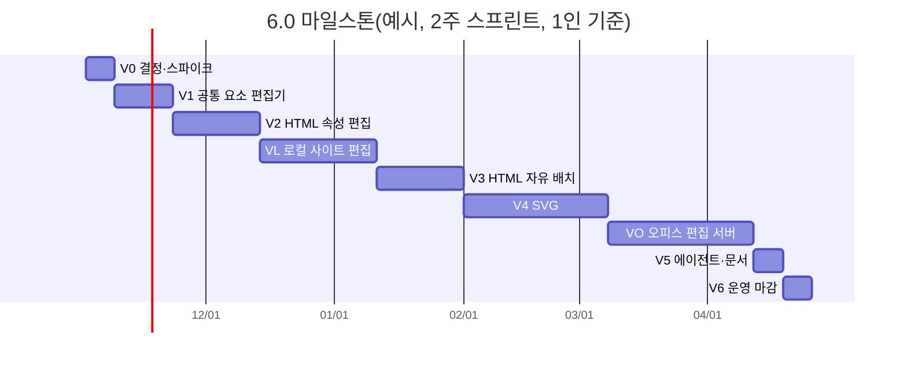

# 6.0 요구사항(계획): 요소 편집기 — PPT 앱처럼 고르고, 옮기고, 속성을 바꾼다

5.0은 "글자를 넘어 표·이미지까지"를 목표로 했지만, HTML 문서는 원본 디자인을 지키려고 스타일·배치 편집을 일부러 뺐다(D-48, 5.0 4.1 "임의 CSS 편집·레이아웃 바꾸기는 하지 않는다"). 사용자가 기대한 것은 **요소를 고르고 속성 패널에서 글꼴·크기·색·너비·높이를 바꾸고, 그림·SVG를 원하는 자리에 올려 옮기고 크기를 바꾸는** PPT식 편집이다. 6.0은 그 차이를 메운다.

> 상태: **v0.3 (2026-11-02).** D-54·D-56·D-57·D-58 확정(사용자, 2026-10-30): HTML은 문서 어디서나 자유 배치, SVG는 draw.io(자체 호스팅) + svgedit, 로컬 사이트도 편집. D-55·D-59·D-60 확정(사용자, 2026-11-02): HTML 허용 스타일은 V0 초안, DOCX·PPTX 서식 편집은 6.0에 넣는다(ONLYOFFICE, 7절 VO), SVG는 파일 참조 기본. V0 스파이크 결과(11절)를 4.2·4.4·D-55에 반영했다: HTML 고정 위치의 가로 좌표는 %, draw.io는 별도 하위 도메인, svgedit 캔버스는 MIT, SVG 소독은 htmlparser2 허용 목록.
> 근거 조사: 현황 조사(코드·명세 대조), 외부 조사(시각 편집기·SVG 편집기·Tiptap, 2026-10-30, 10절).

---

## 1. 요구 정리

| # | 요구(사용자, 2026-10-30) | 지금 | 6.0에서 |
|---|---|---|---|
| R1 | 글꼴 크기·패밀리 조정 | 덱만 블록 단위 크기(패밀리 칸 없음). HTML 없음 | HTML·덱 공통 속성 패널 + 글자 도구 막대(블록·선택 글자) |
| R2 | 표 너비·높이 조정 | 열 너비 %만(HTML은 숫자, 덱은 끌기). 행 높이·표 전체 너비 화면 없음 | 열 경계 끌기, 행 높이 끌기·숫자, 표 너비 손잡이 |
| R3 | 그림을 원하는 위치에 올리고, 옮기고, 크기 바꾸기 | 덱만 자유 배치. HTML은 고른 블록 뒤에 넣기, 너비 % 슬라이더 | HTML 문서 어디서나 그림·글상자·SVG를 끌어 놓은 자리에 두고 x·y·크기로 옮긴다(D-54) |
| R4 | SVG 올려 편집한 뒤 HTML에 첨부 | SVG 자산 업로드 불가(PNG·JPEG·WebP·GIF만), 도형 편집 없음(글자만) | SVG 자산, draw.io 임베드로 그리기·고치기, HTML·덱에 넣기 |
| R5 | PPT 앱처럼 요소 편집(에디터 또는 props) | 덱 편집기에만 있음. 그마저 글자 도구 막대·정렬 버튼이 미완성 | 덱 편집기의 캔버스·속성 패널을 공통 "요소 편집기"로 키워 HTML에도 쓴다 |

## 2. 지금 상태와 차이 (현황 조사)

| 차이 | 원인 | 성격 |
|---|---|---|
| 로컬 사이트에서는 글자만 고칠 수 있다(구조·덱·PDF 편집 버튼이 Cloudflare에만 있음) | D-51 "Cloudflare 앱만 편집, 로컬은 보기" | 설계 |
| HTML 문서에 글꼴·크기·색·행 높이·그림 좌표를 바꾸는 연산이 없다. 글자 편집은 `span` 속성을 버린다(`structedit/html.ts` sanitize) | D-48, 5.0 4.1 | 설계상 금지 |
| 오피스(DOCX·PPTX) 서식·그림 위치 편집이 없다 | D-47 C(표 행·열·열 너비·그림 교체만) | 설계상 범위 밖 |
| SVG 업로드·도형 편집·HTML 첨부가 없다 | 어느 결정에도 범위로 잡히지 않음 | 미구현 |
| 덱 글자 도구 막대(굵게·색·링크), 글꼴 칸, 여러 요소 정렬·분배가 없다 | 명세 06절에 있으나 구현이 덜 됨 | 미완성 |
| HTML 표 열 끌기, 글자 색이 5.0 6절 표에는 ○인데 실제로 없다 | 명세와 구현 불일치 | 미완성 |

리포 HTML 문서(고유 약 9개)에서 자유 편집이 부딪힐 점:
- 색 토큰 이름이 문서마다 다르다(`--fg/--bg`, `--ink/--ground`, `--paper/--teal`). hex를 바로 넣으면 다크 모드가 깨진다.
- 레이아웃은 class + 고정 폭 격자(`grid-template-columns: 132px …`)다. 절대 위치를 아무 데나 넣으면 640px 이하 카드 전환·가로 스크롤 금지 규칙(`.claude/rules/html-docs.md`)과 충돌한다.
- 다이어그램은 인라인 SVG이고 원본은 `.drawio`·`.mmd`다. HTML 안 SVG를 직접 고치면 원본과 어긋난다.

## 3. 방식: 프레임워크 없이 지금 기반을 넓힌다

| | A. 자체 확장(추천) | B. A + svgedit | C. GrapesJS를 캔버스로 |
|---|---|---|---|
| 무엇 | react-moveable·속성 패널·Tiptap(이미 씀)을 공통 요소 편집기로 묶고, 서버 연산(`setStyle` 등)을 넓힌다. 새 SVG는 draw.io 임베드 | A에 더해 업로드한 임의 SVG를 svgedit 캔버스(`@svgedit/svgcanvas` 7.4.2)로 도형 단위 편집 | GrapesJS 0.23.8(BSD-3)로 편집하고 변경을 연산으로 바꿔 저장 |
| 원본 바이트 보존 | 유지(연산이 바뀐 구간만 다시 씀) | 유지 | 깨짐(GrapesJS는 문서를 자기 모델로 읽고 다시 써 낸다) |
| 에이전트와 같은 연산 | 유지 | 유지 | 이중화(프레임워크 명령 ↔ 연산) |
| 보안 모델(스크립트 없는 편집 사본) | 이미 검증됨 | 같음 | 자체 iframe, 호환 미확인 |
| 구현량(1인+Claude Code) | 약 7스프린트(7절) | +1스프린트 | 스파이크 + 어댑터, 불확실 |
| 위험 | react-moveable 0.56.0이 2023-12 이후 릴리스 없음(대안 interactjs) | svgedit 라이선스 표기가 복합(LGPL 포함) | 저장 모델 충돌, `@grapesjs/react` 2.0이 0.22.x에만 맞음 |

GrapesJS·Puck·Craft.js·Builder.io·Plasmic·Webstudio(AGPL)·Silex(AGPL)는 각자 문서 모델을 가진 페이지 빌더라 "이미 있는 HTML 문서를 원본 그대로 고친다"는 이 제품의 전제와 맞지 않는다. tldraw·Polotno는 상용 라이선스다.

## 4. 편집 모델

### 4.1 공통 요소 편집기

덱 편집기(`site/web/src/viewers/deck/editor/`)의 캔버스·선택·Moveable·속성 패널·Tiptap을 문서 종류와 무관한 **요소 편집기**로 떼어 낸다. HTML 구조 편집과 덱 편집이 같은 화면 틀을 쓴다.

- 고르기: 클릭, Shift 여러 개, Esc 부모, 레이어(요소 트리) 패널에서 고르기
- 손잡이: 8방향 크기, 드래그 이동(자유 배치 요소), 방향키 1px·Shift 8px, 스냅(경계·가운데·이웃 요소)
- 속성 패널: 요소 종류(글자·상자·표·그림·SVG)별 칸. 값은 연산으로 저장되고 되돌리기(⌘Z)로 돌아간다
- 글자 도구 막대(선택한 글자): 굵게·기울임·밑줄·글자색·링크·글꼴·크기. Tiptap 3 `TextStyle`·`FontFamily`·`FontSize`·`Color`(무료)
- 여러 요소: 정렬(왼·가운데·오른·위·중간·아래), 분배, 복제(⌘D), 앞으로·뒤로

### 4.2 HTML 문서 (D-48을 D-54로 바꾼다)

**속성 편집**과 **문서 어디서나 자유 배치**(D-54 확정)를 더한다. 흐름 레이아웃 요소는 그대로 두고, 사용자가 옮긴 요소만 고정 위치가 된다.

- **속성 편집(`setStyle`)**: 어떤 블록이든 고르면 속성 패널에서 글꼴 패밀리·크기·굵기·색·줄 간격·정렬, 너비·높이, 안쪽·바깥 여백·배경·테두리를 바꾼다. 원본의 `style` 속성만 다시 쓴다. 허용 속성은 덱 형식의 검사기(`slide/css.ts`)를 기본으로 문서용 목록을 둔다(D-55).
- **색은 문서 토큰 먼저**: 편집 사본에서 `:root`의 색 CSS 변수를 모두 읽어 견본으로 보여 주고(문서마다 토큰 이름이 다르고 `--accent`가 없는 문서도 있다) `var(--accent)`처럼 넣는다. hex를 고르면 "다크 모드에서 안 바뀜" 안내를 띄운다.
- **글자 일부 서식**: 글자 편집이 `span style`을 허용 속성(색·굵기·글꼴·크기)만 남기도록 sanitize를 넓힌다.
- **표**: 열 경계 끌기(이웃 두 열만 주고받기, 합 100%), 행 높이(`tr` height 끌기·숫자), 표 전체 너비 손잡이. `table-layout: fixed`가 없는 표는 열 너비를 바꿀 때 함께 넣는다(diff에 보인다).
- **그림(흐름 속)**: 손잡이로 크기(비율 유지), 왼·가운데·오른 정렬, 캡션.
- **자유 배치**: 어떤 요소든 끌면 "고정 위치로 전환"(`toPinned`, 덱과 같은 연산)된다. 기준 상자는 가장 가까운 섹션(`section`·`main` 바로 아래 블록)이고, 연산이 그 섹션에 `position: relative`와 최소 높이를 함께 넣어 고정 요소가 섹션 밖으로 넘치지 않게 한다. 새 그림·글상자·SVG는 끌어 놓은 자리에 고정 위치로 들어간다. 좌표는 섹션 기준으로 **가로(`left`·`width`)는 섹션 너비의 %, 세로(`top`)는 px**다. px로만 두면 641~1024px 폭에서 리포 문서 8개 중 7개에 가로 스크롤·섹션 밖 넘침(최대 312px)이 생겼다(11절). 덱은 고정 캔버스라 px 그대로다. `section`·`main`이 없는 문서는 본문 감싸개 바로 아래 블록을 기준으로 쓰고, 표 칸 안 요소는 따로 고정하지 않고 표 전체만 옮긴다.
- **좁은 화면**: 고정 위치 요소는 640px 이하에서 흐름으로 돌아가 원래 자리(문서 순서)에 쌓인다. 연산이 문서 `<head>`에 한 번 작은 규칙(`@media (max-width:640px){[data-pin]{position:static!important;…}}`)을 넣는다. 가로 스크롤 금지 규칙을 지키기 위한 장치다. 그 대신 좁은 화면에서는 배치가 PPT 화면과 달라진다(위험 8절).
- **겹침 순서**: 섹션 안 문서 순서가 그리는 순서다(덱과 같은 규칙). 앞으로·뒤로는 문서 안에서 자리를 옮긴다(`move`).
- 하지 않는 것: 스크립트, `<style>` 블록·class 규칙 편집(인라인 `style`과 좁은 화면 규칙 한 줄만), 회전·그림자 같은 장식.

### 4.3 슬라이드 덱

명세 06절의 미완성 부분을 마감하고 공통 요소 편집기로 옮긴다: 글자 도구 막대, 글꼴 패밀리 칸(덱 `faces`에서 고름), 행 높이, 여러 요소 정렬·분배, 레이어 패널.

### 4.4 SVG

| 단계 | 방식 |
|---|---|
| 올리기 | 자산에 `image/svg+xml`을 더한다. 서버가 저장 전에 소독한다(script·`on*` 속성·`foreignObject` 안 HTML·외부 `href` 제거, 허용 요소 목록). 이것이 이번 범위에서 가장 큰 보안 위험이다 |
| 새로 그리기·고치기 | **draw.io 임베드**(iframe + postMessage). 저장은 `xmlsvg`(편집용 다이어그램 XML을 SVG 안에 넣은 형식)라서 다시 열면 그대로 이어서 고친다. 이 리포의 "다이어그램 원본은 `.drawio`" 규칙과 맞는다. 메시지는 `event.origin`·`event.source`를 확인한다 |
| 업로드한 일반 SVG 고치기 | **svgedit 캔버스**(`@svgedit/svgcanvas` 7.4.2, D-56 확정 B안)로 도형 고르기·이동·크기·채움·선·글자·도형 추가. 저장은 SVG 파일 통째(새 자산). 인라인 SVG의 색·글자만 바꿀 때는 요소 편집기의 속성 연산(`svgAttr`)으로 바로 고친다 |
| HTML·덱에 넣기 | 기본은 **파일 참조**(`.svg">`, 덱은 `asset:`). 문서 글꼴·색 토큰을 따라야 하면 **인라인**(소독 후 `<svg>` 그대로, D-60) |

draw.io 호스팅(D-57 확정: 자체 호스팅, V0에서 동작 확인): `draw.war`(v32.6.1, 파일 3,124개·119MB, 가장 큰 파일 20.2MB)를 풀어 **콘텐츠 도메인과도 다른 별도 하위 도메인**(예: `draw.simplite.net`)의 정적 자산 Worker로 연다. 콘텐츠 도메인에 두면 사용자 HTML이 draw.io의 localStorage·창에 닿는다. 그 출처의 CSP는 `connect-src 'self'`·`frame-ancestors <앱 출처>`이고, draw.io가 `unsafe-eval`을 쓴다. 앱 CSP에는 `frame-src`만 더한다. 외부 요청은 0건이었다. export 응답의 `format`은 `xmlsvg`를 요청해도 `svg`로 오므로 요청 순서로 짝짓는다. 파일당 25MiB 한도 때문에 draw.io를 올릴 때마다 가장 큰 파일 크기를 확인한다. 새 Worker·도메인은 V4 시작 때 사용자 확인을 받고 만든다.

svgedit(V0 확인): 쓰는 것은 `@svgedit/svgcanvas` 7.4.2이고 **MIT**다. LGPL 표기는 편집기 앱 `svgedit`의 옛 목록에서 온 것이고 해당 파일은 7.4.2에 없다. MIT·pathseg(BSD형) 고지를 둔다. 소스를 직접 가져오고 jspdf·svg2pdf를 빈 모듈로 바꾸면 gzip 64kB(dist 그대로면 326kB)다. 꺼낼 때 `viewBox`가 빠지고 `Layer 1` 묶음이 생기므로 저장 전에 되돌린다. draw.io SVG(루트에 `content` 속성이 있는 것)는 svgedit가 `content`를 지우므로 draw.io로만 연다.

SVG 소독(V0 선정): `packages/core`에 이미 있는 htmlparser2(xmlMode)로 **직접 만든 허용 목록**. 공격 샘플 18건 차단(실제 Chrome), 정상 SVG 4개 픽셀 차이 0%, draw.io `content` 보존, workerd에서 동작. DOMPurify(linkedom·happy-dom)와 sanitize-html은 Workers에서 돌지 않거나 공격 4~5건을 통과시켰다. 인라인 SVG는 안의 `<style>`·id가 문서 전체에 걸리므로 범위를 좁혀 넣는다(D-60 파일 참조 기본의 근거).

### 4.5 연산 확장 (사람 화면과 MCP가 같이 쓴다)

| 연산 | HTML | 덱 | 내용 |
|---|---|---|---|
| `setStyle` | 새로 | 있음 | 허용 속성만, 역연산을 돌려준다 |
| `insert` 넓히기 | 자유 배치 영역·글상자·SVG(파일·인라인) | SVG | 위치(x·y) 포함 |
| `duplicate` | 새로 | 있음(화면 ⌘D) | 연산으로 올린다(에이전트도 쓰게) |
| `tableRowHeight` | 새로 | `setStyle`로 | `tr` 높이 |
| `svgAttr` | 새로 | 새로 | 인라인 SVG 안 도형의 fill·stroke·글자 |
| MCP | `doc_ops`에 위 연산, `svg_put`(SVG 자산 올리기, 소독 결과 진단) | `slide_patch` 그대로 | 잘못된 값은 진단(fix 포함) |

## 5. 형식별 6.0 기능

○ 6.0, △ 일부, — 하지 않음, (지금) 5.0에 있음, (오) 오피스 편집 서버(ONLYOFFICE)가 제공(D-59, XLSX도 같은 편집기로 연다). 에이전트용 OOXML 연산(D-47 C)은 그대로 둔다.

| 기능 | HTML | 슬라이드 덱 | DOCX·PPTX | PDF |
|---|---|---|---|---|
| 속성 패널(요소 종류별) | ○ | ○(지금 + 글꼴·행 높이) | (오) | (지금) 도구 막대 |
| 글꼴 패밀리·크기·색(블록) | ○ | ○ | (오) | (지금) 새 글상자 |
| 글꼴·색(선택 글자) | ○ | ○ | (오) | — |
| 표 열 끌기·행 높이·표 너비 | ○ | ○ | (오) | — |
| 그림 크기 손잡이·정렬 | ○ | (지금) | (오) | (지금) |
| 자유 배치(x·y) | ○ 문서 어디서나(섹션 기준) | (지금) | — | (지금) 덧그리기 |
| SVG 올리기·넣기 | ○ | ○ | — | — |
| SVG 그리기·고치기(draw.io·svgedit) | ○ | ○ | — | — |
| 여러 요소 정렬·분배·복제·앞뒤 | ○ | ○ | — | — |
| 레이어(요소 트리) 패널 | ○ | ○ | — | — |
| 로컬 사이트에서 편집 | ○ | ○ | ○ | ○ |

## 6. 결정 사항

| ID | 질문 | 제안 | 다른 선택지 |
|---|---|---|---|
| D-54 | HTML 편집 범위(D-48 바꿈) | **확정(2026-10-30, 사용자): 속성 편집 + 문서 어디서나 자유 배치.** 옮긴 요소만 섹션 기준 고정 위치, 좁은 화면에서는 흐름으로 돌아감(4.2) | 자유 배치 영역 안에서만, 속성 편집만 |
| D-55 | HTML 허용 스타일 | **확정(2026-11-02, 사용자): V0 초안.** 덱 검사기 목록 기반 + 문서용 추가(V0 초안, 11절): margin·`auto`, 글자 크기·줄 간격 em·rem, 색 `var(--토큰)`. `position`·`left`·`top`은 `setStyle`에서 막고 `toPinned`로만. 그림자·transform·`url()`·vw·vh·`!important` 금지. 글꼴은 문서가 불러온 글꼴 + 일반 계열만. 색은 토큰 우선, hex는 안내 후 허용 | 아무 CSS나 허용(검증 불가), 토큰만 허용(자유도 낮음) |
| D-56 | SVG 편집 도구 | **확정(2026-10-30, 사용자): draw.io 임베드(새 그림·draw.io SVG) + svgedit(업로드한 일반 SVG)** | 일반 SVG는 색·글자만, 편집 없이 올리기만 |
| D-57 | draw.io 호스팅 | **확정(2026-10-30, 사용자): 자체 호스팅.** V0에서 안 되면 다시 묻는다 | `embed.diagrams.net`(외부 iframe에 내용이 들어감) |
| D-58 | 로컬 사이트 편집(D-51 바꿈) | **확정(2026-10-30, 사용자): 로컬도 편집.** 로컬 서버에 수정본 층(작업본 폴더 + SQLite 수정본 행, 버전으로 저장하면 `vN.N` 폴더와 `meta.yaml`), 자산, 구조·덱·PDF 연산 API를 Worker와 같게 둔다(7절 VL) | Cloudflare만 편집 |
| D-59 | DOCX·PPTX 서식 편집(D-47 재검토) | **확정(2026-11-02, 사용자): 6.0에 넣는다.** 사람 화면은 ONLYOFFICE Docs(커뮤니티판, AGPL, 고치지 않고 이미지 그대로)를 Cloudflare Containers에 띄워 iframe으로 연다(5.0 4.4 A안, 시간당 약 $0.09). 저장 콜백 파일은 수정본 한 건(파일 통째)으로 들어간다. 에이전트 연산(D-47 C)은 그대로 둔다. 컨테이너·시크릿은 VO 시작 때 사용자 확인 후 만든다 | 6.0 범위 밖(D-47 C 유지) |
| D-60 | SVG를 HTML에 넣는 기본 방식 | **확정(2026-11-02, 사용자): 파일 참조(``)**, 토큰 색이 필요할 때만 인라인 | 늘 인라인 |

## 7. 마일스톤

2주 스프린트, 사람 1명 + Claude Code 기준. 각 마일스톤은 develop → staging으로 확인하고 `spec/TESTING.md`(`TC-VE-…`)에 케이스를 둔다.

| 마일스톤 | 기간 | 내용 | 끝난 기준 |
|---|---|---|---|
| **V0 스파이크** (완료, 11절) | 0.5 | draw.io 자체 호스팅 embed 동작(postMessage 출처 확인, `xmlsvg` 왕복, CSP `frame-src`), svgedit 캔버스를 React에 띄우기·라이선스 확인, 리포 HTML 9개에 `setStyle`·고정 위치 전환·좁은 화면 규칙을 시험 적용해 diff·다크 모드·640px 확인, SVG 소독 라이브러리 선정 | 스파이크 보고서. draw.io 자체 호스팅이 안 되면 에스컬레이션 |
| **V1 공통 요소 편집기** | 1 | 덱 편집기에서 캔버스·선택·손잡이·스냅·속성 패널·되돌리기를 공통 모듈로 분리. 글자 도구 막대(굵게·기울임·밑줄·색·링크·글꼴·크기). 덱 미완성 마감(글꼴 칸, 행 높이, 여러 요소 정렬·분배, 레이어 패널) | 기존 덱 화면 테스트 전부 통과 + 도구 막대·정렬 화면 테스트 |
| **V2 HTML 속성 편집** (완료) | 1.5 | HTML `setStyle`(허용 목록·역연산), 토큰 색 견본, 글자 일부 서식(span style), 표 열 끌기·행 높이·표 너비, 흐름 속 그림 손잡이·정렬, 복제, HTML 구조 편집 화면을 요소 편집기로 교체 | core: 연산 뒤 바뀌지 않은 바이트 동일·역연산 왕복. 리포 HTML 전체에 "아무것도 안 바꾸고 저장 = 바이트 동일". 화면: 글꼴 크기·색 바꾸기 → 새로 고침 뒤 유지 |
| **V3 HTML 자유 배치** | 1.5 | 어떤 요소든 끌어 고정 위치로 전환(섹션 기준), 그림·글상자·SVG를 끌어 놓은 자리에 넣기, 이동·크기·앞뒤·스냅·정렬, 섹션 최소 높이 자동 조정, 좁은 화면 규칙 | 화면: 그림을 지정 위치에 올리고 옮긴 좌표 저장(배율별 오차 1px 이내), 640px 이하에서 가로 스크롤 없음, 다른 섹션 바이트 동일 |
| **V4 SVG** | 2.5 | SVG 자산(서버 소독), HTML·덱에 파일 참조·인라인으로 넣기, draw.io 임베드(자체 호스팅)로 새로 그리기·고치기(`xmlsvg`), svgedit로 업로드 SVG 고치기, 인라인 SVG 색·글자 속성 편집(`svgAttr`) | 소독 테스트(스크립트·이벤트 속성·외부 주소 제거), draw.io로 그려 넣고 다시 열어 고치기, svgedit로 도형 색·위치 바꿔 저장 화면 테스트 |
| **VL 로컬 사이트 편집** | 2 | 로컬 서버에 수정본 층(작업본 폴더·SQLite 수정본 행·되돌리기·버전으로 저장 → `vN.N` 폴더와 `meta.yaml`), 자산(`docs/` 밖 캐시 + 버전에 넣을 때 복사), 구조·덱·PDF·SVG 연산 API를 Worker와 같은 모양으로. 화면의 `CLOUD` 조건 편집 버튼을 로컬에도 연다. 로컬 MCP도 같은 도구 | 로컬·Cloudflare 같은 연산 테스트(2.4·2.7 맞추기), 로컬에서 고친 뒤 `git diff`가 버전 폴더 추가와 `meta.yaml`뿐 |
| **VO 오피스 편집 서버** | 2.5 | ① Containers(standard-3)에 ONLYOFFICE 이미지(약 3.1GB, 한글 글꼴 포함) 올리기·콜드 스타트·비용 측정(5.0 M0에서 로컬만 확인) ② 편집 설정 발급(JWT, 시크릿)·파일 내려주기·저장 콜백 → 수정본(파일 통째)·실시간 반영, 동시 편집은 ONLYOFFICE 공동 편집에 맡기고 작업본 잠금 ③ DOCX·PPTX·XLSX 화면에 「오피스 편집기로 열기」, 서버가 꺼져 있으면 깨우는 동안 진행 표시 ④ 로컬은 docker로 같은 이미지(없으면 버튼 숨김) ⑤ 유휴 종료·사용량 지표 | 화면: DOCX 글꼴·크기·색, PPTX 도형 이동, XLSX 서식을 바꿔 저장 → 새 수정본·버전 저장 뒤 원본 다른 부분 유지. 콜백 JWT 위조 거부 테스트. 콜드 스타트·시간당 비용 기록 |
| **V5 에이전트·문서** | 0.5 | MCP `doc_ops` 연산 추가, `svg_put`, 스킬·가이드 갱신 | MCP 테스트: 에이전트가 글꼴·자유 배치·SVG 넣기를 연산으로 수행, 진단에 fix |
| **V6 운영 마감** | 0.5 | 보안 점검(SVG 소독·draw.io 메시지·스타일 주입·오피스 콜백 JWT), staging 전체 회귀, 운영 배포 | 보안 점검 높음 이상 0, staging 회귀 통과 |

합계 약 12.5스프린트(25주, D-59로 VO 2.5 추가). V1이 끝나야 V2~V4가 시작되고, V3·V4는 서로 의존이 없다. VO는 요소 편집기와 의존이 없어 V1과 나란히 진행할 수 있다(한 사람이면 V4 뒤). VL은 V1 뒤 언제든 시작할 수 있지만, 연산이 늘어날 때마다 로컬에도 맞춰야 하므로 V2 직후에 두어 이후 마일스톤이 처음부터 양쪽에 같이 들어가게 한다.

## 8. 위험과 대응

| 위험 | 대응 |
|---|---|
| 인라인 스타일이 문서 디자인 체계·다크 모드를 깬다 | 토큰 색 우선, hex 안내, 저장 전 diff, 리포 HTML 전체로 회귀 |
| SVG로 스크립트가 들어온다 | 서버 소독(htmlparser2 허용 목록, V0 공격 18건 세트를 회귀 테스트로) + 콘텐츠 도메인 분리 유지, 보안 점검 범위에 넣는다 |
| draw.io 외부 iframe에 내용이 나간다 | 자체 호스팅 우선(D-57), 메시지 출처 확인 |
| 오피스 편집 서버 비용·콜드 스타트·AGPL(D-59) | 유휴 종료와 사용량 지표, 깨우는 동안 진행 표시. 이미지는 고치지 않고 그대로 써서 AGPL 소스 공개 의무가 생기지 않게 하고, 고지는 남긴다. Containers에서 안 되면 에스컬레이션 |
| react-moveable 릴리스 정체 | 공통 모듈 뒤에 감춰 interactjs로 바꿀 수 있게 둔다 |
| 문서 어디서나 자유 배치라 디자인·반응형이 깨진다(D-54) | 옮긴 요소만 고정 위치, 섹션 기준 좌표·최소 높이 자동, 640px 이하에서는 흐름으로 되돌림. 저장 전 diff·좁은 화면 미리보기 |
| 로컬 편집이 파일 원본과 어긋난다(D-58) | 작업본은 `docs/` 밖에 두고, 버전으로 저장할 때만 `vN.N` 폴더·`meta.yaml`을 쓴다(지금 버전 규칙 그대로) |
| 편집기 번들이 커진다 | 편집기·draw.io는 동적 import, 보기 화면에는 싣지 않는다 |

## 9. 5.0 마무리와의 관계

- 5.0은 PR #3으로 production에 배포했다(2026-10-30, HTML PDF 내보내기·진행 막대 포함).
- 5.0 6절 표 중 실제로 없는 HTML 항목(열 끌기, 글자 색)은 6.0 V2에서 채운다.

## 10. 참고

- 현황: `spec/REQUIREMENT-5.0.md` 4.1·6절·D-47·D-48·D-51, `docs/slide-editor-spec.html` 06·16절, `packages/core/src/structedit/html.ts`, `packages/core/src/slide/css.ts`, `site/web/src/viewers/deck/editor/Inspector.tsx`
- 외부 조사(2026-10-30, npm 레지스트리 기준 버전):
  - [GrapesJS](https://github.com/GrapesJS/grapesjs)·[Component API](https://grapesjs.com/docs/api/component.html), [Puck](https://github.com/puckeditor/puck), [Craft.js](https://craft.js.org/docs/overview), [Webstudio](https://github.com/webstudio-is/webstudio), [Silex](https://github.com/SilexLabs/Silex)
  - [draw.io embed mode](https://www.drawio.com/doc/faq/embed-mode), [drawio-integration](https://github.com/jgraph/drawio-integration), [jgraph/drawio](https://github.com/jgraph/drawio)
  - [SVG-Edit](https://github.com/SVG-Edit/svgedit), [Fabric.js loadSVGFromString](https://fabricjs.com/api/functions/loadsvgfromstring/), [tldraw 라이선스](https://tldraw.dev/community/license), [Polotno SVG import](https://polotno.com/docs/svg-import)
  - [Tiptap FontSize](https://tiptap.dev/docs/editor/extensions/functionality/fontsize), [Tiptap Table](https://tiptap.dev/docs/editor/extensions/nodes/table)
  - [react-moveable](https://github.com/daybrush/moveable)

## 11. V0 스파이크 결과 (2026-10-30)

리포 파일·`docs/`·Cloudflare는 건드리지 않고 임시 폴더에서 시험했다. 결과는 4.2·4.4·D-55에 반영했다.

| 스파이크 | 결과 | 설계에 반영한 것 |
|---|---|---|
| draw.io 자체 호스팅 | **동작.** 서로 다른 출처에서 `init` → XML `load` → `xmlsvg` export → 그 SVG 다시 `load` → 다이어그램 복원(puppeteer). `save`·`exit` 이벤트가 오고, 같은 페이지의 위조 `save`는 `origin`·`source` 확인으로 걸러지고, `frame-ancestors` 밖 부모에는 뜨지 않는다. 외부 요청 0건 | 별도 하위 도메인 정적 Worker, CSP, export는 요청 순서로 짝짓기, 소독기는 `content` 보존 |
| svgedit 캔버스 | `@svgedit/svgcanvas` 7.4.2는 MIT. React 위에서 고르기·이동·크기·fill·되돌리기·도형 추가·글자·꺼내기 동작. gzip 64kB(jspdf 제외) | `viewBox`·`Layer 1` 되돌리기, draw.io SVG는 draw.io로만 |
| SVG 소독기 | htmlparser2 허용 목록: 공격 18건 차단, 정상 SVG 픽셀 차이 0%, workerd 동작. DOMPurify+linkedom은 동작하지 않고, DOMPurify+happy-dom은 5건·sanitize-html은 4건 통과 | htmlparser2 허용 목록 채택, 공격 세트를 테스트로 |
| HTML `setStyle`·`toPinned`(지금 버전 대표 HTML 8개) | 바뀐 줄 5~6줄(요소·섹션 시작 태그·`</head>` 앞 규칙 한 줄), 나머지 바이트 같음. 토큰 색은 다크 모드에서 따라 바뀜. 640·375px에서 흐름으로 돌아오고 가로 스크롤 없음. **px 좌표는 641~1024px에서 7개 문서가 넘침** → 가로 % 좌표로 바꾸니 7가지 폭 모두 넘침 0 | 가로 % 좌표, `<head>` 없는 문서는 규칙 넣을 자리를 차례로 찾기, 섹션 없는 문서는 감싸개 아래 블록, 표 칸 안 요소 고정 금지, 고르기 대상에 `div` 추가(V2), 색 견본은 문서 토큰 전체 |

V2·V3에서 마저 볼 것: 섹션 아래쪽 고정 요소가 640px 근처에서 다시 줄바꿈될 때 넘치는지, 편집 화면에서 % 좌표로 끌기·스냅할 때 섹션 폭을 다시 재는 시점, A4 PDF(인쇄 폭 약 718px)에서 고정 배치.

## 12. 진행 결과

**V2 HTML 속성 편집 (2026-11-02)**

- core(`structedit/html.ts`·`docstyle.ts`): `setStyle`(D-55 허용 목록, 기존 선언 순서 유지·같은 속성 제자리, position·left·top은 막음, 글꼴은 문서가 쓰는 글꼴 + 일반 계열), `tableRowHeight`, `duplicate`(안의 id 뺌), 글자 안 span style(color·font-family·font-size·font-weight), 열 너비를 바꾸면 `table-layout:fixed`를 함께, 고를 수 있는 요소에 `div`, 블록 목록에 인라인 style·감싸는 블록·깊이, 문서 견본 `docTheme`(글꼴·`:root` 색 토큰·다크 모드).
- Worker·MCP: 구조 응답에 `theme`, 수정본 메모(서식·표 행 높이·복제), `doc_structure`가 글꼴·색 토큰과 블록 style을 보여 주고 `doc_ops` 설명에 새 연산.
- 화면(`viewers/structedit/`): 속성 패널(`HtmlStylePanel`), 글자 편집 중 도구 막대(`editor/TextToolbar`를 상태·명령 어댑터로 나눠 HTML contenteditable에도 씀, `inlineText.ts`), 표 열 경계·행 높이·표 너비·그림 크기 손잡이(`HtmlHandles`, 감싸는 상자 대비 %), 그림 정렬, 복제(⌘D), ⌘Z·⇧⌘Z, Esc 부모 고르기, 레이어 패널(`editor/LayerPanel`).
- 계획과 다른 점: 역연산을 따로 두지 않았다. HTML은 연산 하나가 수정본 하나라 되돌리기는 수정본 복원으로 한다(5.0 구조 편집과 같은 방식). 덱 캔버스(Moveable)와 HTML은 겹치는 부분이 없어 공통 캔버스 모듈은 만들지 않았다. HTML은 배율 없는 iframe 위 손잡이 층이고, 공통으로 쓴 것은 글자 도구 막대(상태·명령 어댑터)와 레이어 패널이다. 공통 캔버스는 V3 자유 배치에서 다시 본다.
- 테스트: TC-VE-03~09, TC-CFUI-20.
